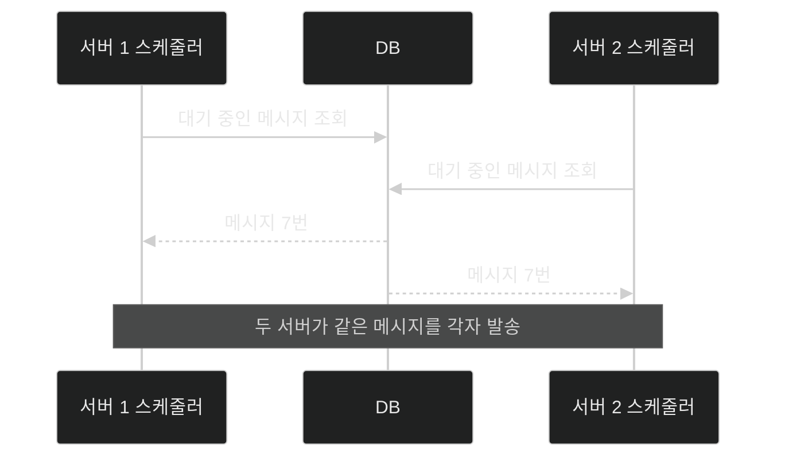
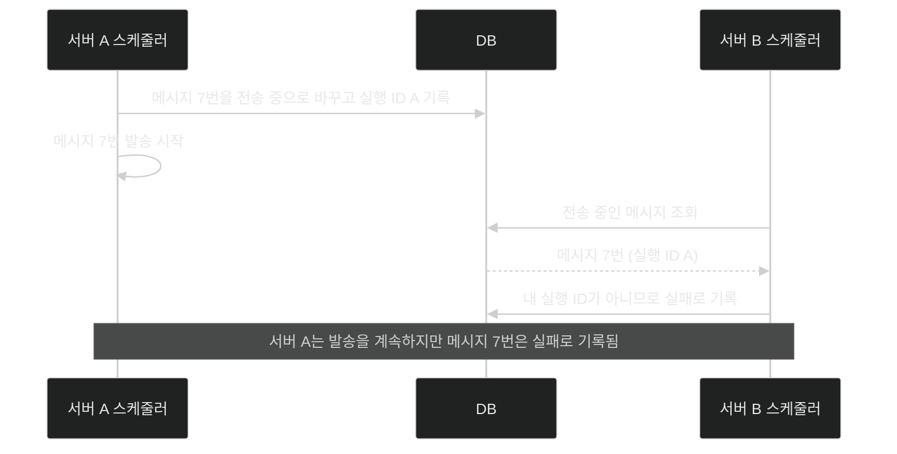

> 2023년 작업을 퇴사 후 정리한 글입니다. 코드는 실제 소스가 아닌 설명용 예시입니다. 서비스가 특정되지 않도록 회사명과 서비스명, 이용자 규모, 일부 시기는 일부러 밝히지 않거나 대략적으로만 적었습니다.

## 1. 들어가며

이 글은 관리자 사이트에 대량 문자 발송 기능을 단독으로 설계·구현하고, 팀 코드 리뷰를 거쳐 보완한 기록입니다. 서비스 이용자는 수십만 명 규모였고, 문자는 외부 문자 발송 API로 나갔습니다. 이 API는 같은 내용을 여러 번호에 한 번의 요청으로 보내는 **동보 발송**을 지원했고, 요청당 최대 1,000개까지 넣을 수 있었습니다.

## 2. 배포 없이 문자를 보낼 수는 없을까?

2023년, 서비스 종료를 앞두고 이용자에게 안내 문자를 보내야 했습니다. 관리자용 문자 발송 기능이 없어서 개발자가 일회성 스케줄러를 만들어 보냈습니다. 스케줄러는 정해진 시각에 서버가 스스로 실행하는 작업입니다.

문제는 이 스케줄러에 세 가지가 모두 코드에 고정돼 있었다는 점입니다.

- 보낼 문구
- 대상자를 고르는 DB 조회
- 실행할 날짜와 시각

그래서 문구 하나를 바꾸려 해도 코드를 고치고 배포해야 했고, 운영자는 문자를 보낼 때마다 개발자에게 요청할 수밖에 없었습니다. 저는 운영자가 화면에서 문구와 대상자 파일을 올리고, 발송 시각을 정하고, 결과를 내려받을 수 있는 기능을 만들기로 했습니다.

## 3. 등록과 발송 나누기

가장 단순한 구현 방법은 등록 버튼을 누를 때 서버가 즉시 문자 API를 호출하는 것입니다. 하지만 이 방식으로는 맞출 수 없는 요구사항이 세 가지 있었습니다.

| 요구사항           | 즉시 호출 시 문제                                                           |
|--------------------|-----------------------------------------------------------------------------|
| 예약 발송          | 정해진 시각에 보내려면 등록과 발송이 분리돼야 함                            |
| 요청당 수신자 상한 | 수만 명 파일이면 수십 번 나눠 호출해야 하고, 그동안 화면 요청이 끝나지 않음 |
| 결과 확인          | 번호별 성공·실패를 모아 파일로 돌려줘야 함                                  |

그래서 **등록은 화면에서, 발송은 스케줄러에서** 하도록 나눴습니다. 화면은 메시지를 DB에 "대기" 상태로 저장하고, 스케줄러가 주기적으로 대기 중인 메시지를 발송합니다.

## 4. 서버 두 대가 같은 메시지를 가져가면?

등록과 발송을 나누자 새 위험이 생겼습니다. Spring의 스케줄러는 서버마다 따로 실행됩니다. 서버가 두 대면 두 스케줄러가 같은 시각에 대기 중인 메시지를 조회할 수 있었습니다.



스케줄러가 메시지를 조회만 하고 "발송했다"는 표시를 남기지 않으면, 이용자는 같은 안내 문자를 두 번 받게 됩니다.

중복 발송을 일부러 허용하는 서비스도 있지만, 이 서비스에서는 두 가지 이유로 막아야 했습니다. 같은 공지 문자를 두 번 받으면 이용자 불만으로 바로 이어지고, 문자 API는 보낸 건수만큼 비용이 드는 유료 API라서 중복으로 나간 문자는 그대로 추가 비용이 됐습니다. 이 위험은 팀 코드 리뷰를 거치며 막았고, 방법은 5장에서 설명합니다.

## 5. 중복 없이 나눠 보내기

### 메시지에 대기·전송 중·완료 상태를 두었습니다

메시지는 화면에서 등록되면 "대기" 상태로 시작합니다. 예약 시각 전까지는 운영자가 수정하거나 취소할 수 있고, 시각이 지나면 수정과 취소가 불가능합니다. 스케줄러가 메시지를 선점하면 "전송 중"이 되고, 발송이 끝나면 "완료" 또는 "실패"로 상태가 전환됩니다.

### 실행 ID로 먼저 선점하고, 선점한 것만 보냈습니다

스케줄러는 실행될 때마다 실행 ID를 만듭니다. 실행 ID는 스케줄러 실행 한 번을 구분하는 고유한 문자열입니다. 대기 중인 메시지의 상태를 "전송 중"으로 바꾸면서 이 ID를 함께 기록합니다. 그다음 자기 실행 ID가 붙은 메시지만 발송을 시작합니다. 이렇게 처리할 대상을 먼저 표시해 가져가는 것을 **선점**이라고 합니다.

```java
// 대기 메시지 선점 후 발송 (예시)
@Scheduled(fixedDelay = 100_000)   // 이전 실행이 끝나고 100초 뒤 다시 실행
public void sendWaitingMessages() {
    String runId = UUID.randomUUID().toString();
    messageRepository.markSending(runId);   // 대기 → 전송 중, runId 기록

    List<Message> sendingList = messageRepository.findByStatus(Status.SENDING);

    for(Message message : sendingList) {
        if(!runId.equals(message.getRunId())) {
            // 다른 실행이 표시한 메시지: 보내지 않고 실패로 기록 (생략)
            continue;
        }
        send(message);
    }
}
```

선점 UPDATE는 "대기" 상태인 메시지만 바꿉니다. 그래서 두 서버가 같은 메시지를 동시에 바꾸려 해도 DB가 한쪽씩 처리하고, 뒤의 서버는 이미 "전송 중"인 메시지를 건너뜁니다.

여기서 중요한 점은 이전 실행이 도중에 멈춰 "전송 중"으로 남은 메시지도 다시 보내지 않고 실패로 처리한다는 것입니다. 같은 문자를 두 번 보내지 않는 것을 우선했기 때문입니다.

메시지 전달 방식은 크게 두 가지입니다. 실패하면 다시 보내 중복을 감수하는 "최소 한 번(at-least-once)", 중복 없이 일부 유실을 감수하는 "최대 한 번(at-most-once)"입니다. 저는 최대 한 번 방식을 선택했습니다. 4장에서 설명했듯이 중복은 이용자 불만과 추가 비용으로 바로 이어지지만, 일부가 발송되지 않는 것은 감수할 수 있었기 때문입니다. 동일한 내용의 안내가 사이트 공지사항에 이미 올라가 있어서, 문자를 받지 못한 이용자도 공지로 확인할 수 있었습니다.

다만 이 선택에는 대가도 있었습니다. 진행 상황을 메시지 단위로만 기록해서, 서버가 발송 도중 멈추면 나머지를 이어서 보낼 수 없었습니다.

### 작은 단위로 나눠 보내고, 결과를 엑셀로 돌려줬습니다

외부 API에 요청이 몰리지 않도록 상한보다 작은 단위로 묶고, 묶음 사이에 대기 시간을 두었습니다.

```java
// 분할 발송 (예시)
int batchSize = 100;   // 부하 분산을 위해 상한(1,000)보다 작게 묶음

for(int start = 0; start < phones.size(); start += batchSize) {
    int end = Math.min(start + batchSize, phones.size());
    List<String> batch = phones.subList(start, end);

    if(message.isSms()) {
        results.addAll(sender.sendSms(message, batch));
    }else {
        results.addAll(sender.sendMms(message, batch));
    }
    Thread.sleep(waitMillis);   // 묶음 사이 대기
}
```

코드처럼 SMS와 MMS는 각각의 발송 방식으로 보냈습니다. MMS는 긴 문구나 제목을 보낼 수 있는 문자입니다.

발송이 끝나면 엑셀 파일을 만들었습니다. 첫 시트에는 운영자가 올린 원본을, 두 번째 시트에는 번호별 결과 코드와 메시지를 담았습니다. 비어 있거나 잘못된 번호처럼 보내지 않은 번호도 사유와 함께 남겨, 운영자가 원본과 결과를 한 줄씩 맞춰 볼 수 있게 했습니다. 운영자가 올린 대상자 파일은 CSV여서 시트를 추가할 수 없었기 때문에 엑셀로 변환했습니다.

## 6. 한계와 지금 다시 한다면

운영 중에 드러난 문제는 아니어도 지금 다시 보면 실패 처리에 약점이 있습니다.

저는 스케줄러 실행이 도중에 멈추면, 남은 메시지들은 "실패"로 처리하게 했습니다. 그런데 실행 ID만 다르면 모두 실패로 바꾸는 로직 때문에, 다른 서버가 지금 보내고 있는 메시지까지 실패로 기록할 수 있었습니다. 단일 서버가 아닌 다수의 서버에서는 이런 문제를 고려해야 했습니다.



서버 B는 메시지 7번을 실패 처리 대상으로 판단했습니다. 실패 처리 기준이 "실행 ID가 다르다"는 것 뿐이어서, 실패 처리 대상과 발송 중인 메시지를 구분하지 못했기 때문입니다.

지금이라면 실패 처리는 메시지 번호를 지정하고, 실행 시각을 비교하여 "전송 중" 상태로 오래 남은 메시지만 대상으로 하겠습니다.

```sql
-- 실패 처리 쿼리 (예시)
UPDATE message
SET status = 'FAILED', result_msg = '실행 중단'
WHERE id = :messageId
  AND status = 'SENDING'
  AND started_at < now() - interval '30 minutes';   -- 기준 시간
```

서버 간 실행 자체를 하나로 줄이고 싶다면 분산 락도 비교하겠습니다. 분산 락은 여러 서버 중 한 곳만 작업을 실행하게 하는 장치입니다.

## 7. 정리

문자 발송 기능을 구현하면서 운영자가 화면에서 문구, 대상자 파일, 발송 시각을 직접 등록하고 예약 시각 전까지 수정·취소할 수 있게 됐습니다. 문자를 보낼 때마다 코드를 고쳐 배포하던 과정이 없어졌고, 발송 결과는 원본과 번호별 결과를 함께 담은 엑셀로 확인하게 됐습니다.

등록과 발송을 나누면 화면은 가벼워지지만, 발송을 맡은 쪽이 "누가 이 메시지를 가져갔는가"를 책임져야 합니다. 이 기능에서는 실행 ID로 메시지를 먼저 선점하게 해서 이 문제를 풀었고, 실패한 메시지를 다시 보내지 않는 쪽을 택해 중복 발송을 막았습니다.

다만 6장에서 본 것처럼, 멈춘 실행이 남긴 메시지를 정리하는 기준이 느슨하면 다른 서버가 보내고 있는 메시지까지 실패로 기록될 수 있습니다. 여러 서버가 같은 작업을 나눠 가질 때는 누가 가져갔는지와 함께 언제 멈춘 것으로 볼지도 정해 두어야 한다는 것을 이 작업에서 배웠습니다.
