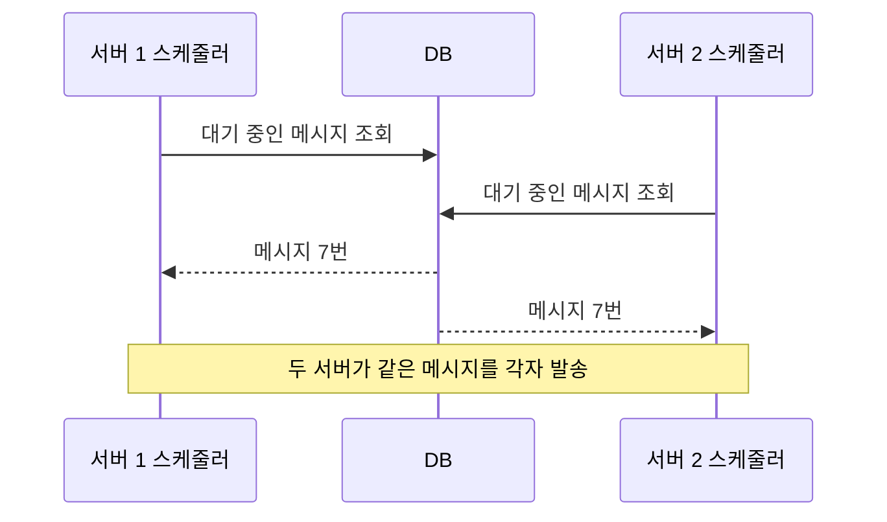
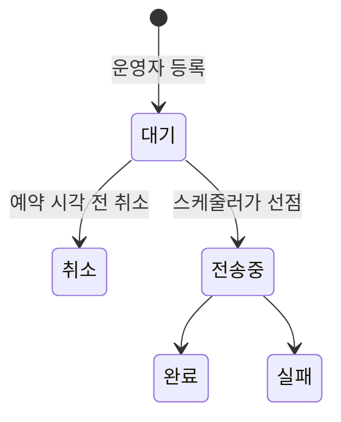
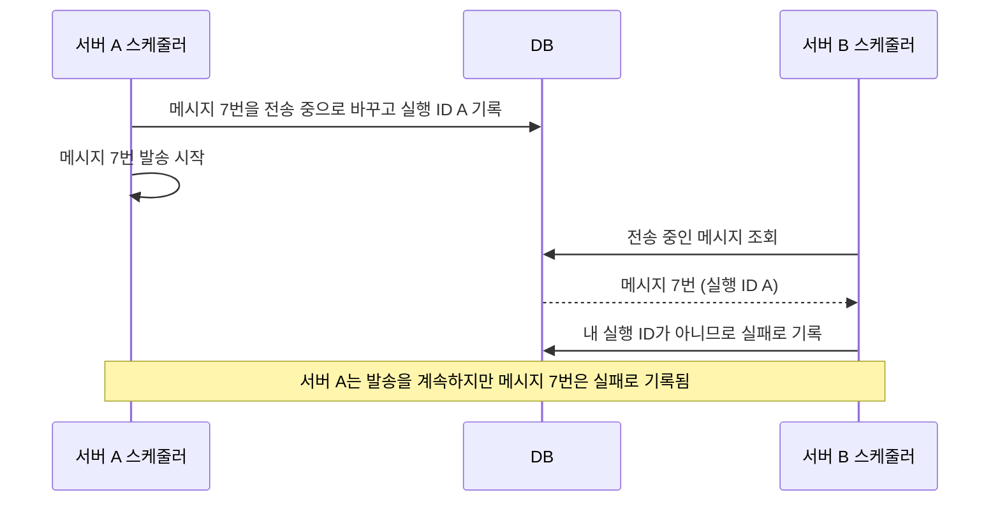

> 이 글은 2023년에 수행한 작업을 퇴사 후 정리한 기록입니다. 코드는 실제 소스가 아니라 원리를 설명하기 위해 새로 작성한 예시이고, 코드 안의 숫자도 예시입니다. 서비스가 특정되지 않도록 회사명과 서비스명, 이용자 규모, 일부 시기는 일부러 밝히지 않거나 대략적으로만 적었습니다.

## 1. 들어가며

저는 대형 통신사가 운영하는 서비스의 관리자 사이트와 API를 개발한 백엔드 개발자였습니다. 이 글은 운영자용 관리자 사이트에 대량 문자 발송 기능을 만든 기록입니다. 구현은 제가 혼자 맡았고, 코드는 팀원 모두가 함께 리뷰했습니다.

이 글에서는 대상 사이트를 **서비스 C**라고 부르겠습니다.

- **서비스 C**: [모의해킹 취약점 조치 글](/posts/untrusted-client-input/)의 서비스 A(콘텐츠 제공사용 관리자 사이트)와 같은 플랫폼에서 운영자가 쓰는 공통 관리자 사이트

서비스의 이용자는 수십만 명 규모였습니다. 이용자에게 보내는 문자는 외부 문자 발송 API로 나갔습니다. 이 API는 같은 내용을 여러 번호에 한 번의 요청으로 보내는 **동보 발송**을 지원했고, 연동 코드에는 요청당 최대 100개라고 적혀 있었습니다.

## 2. 문구 하나 바꾸는 데 배포가 필요했습니다

2023년, 서비스 종료를 앞두고 이용자에게 안내 문자를 보내야 했습니다. 이때는 개발자가 일회성 스케줄러를 만들어 보냈습니다. 스케줄러는 정해진 시각에 서버가 스스로 실행하는 작업입니다.

이 스케줄러에는 세 가지가 코드에 고정돼 있었습니다.

- 보낼 문구
- 대상자를 고르는 DB 조회
- 실행할 날짜와 시각

문구 하나를 바꾸려 해도 코드를 고치고 배포해야 했고, 운영자는 보낼 일이 생길 때마다 개발자에게 요청할 수밖에 없었습니다.

그래서 운영자가 화면에서 문구와 대상자 파일을 올리고, 발송 시각을 정하고, 결과를 내려받는 범용 도구를 만들기로 했습니다.

## 3. 등록과 발송을 나눈 이유

가장 단순한 방법은 등록 버튼을 누를 때 서버가 바로 문자 API를 호출하는 것입니다. 하지만 이 방식으로는 맞출 수 없는 조건이 세 가지 있었습니다.

| 조건 | 바로 호출하면 생기는 문제 |
| --- | --- |
| 예약 발송 | 정해진 시각에 보내려면 등록과 발송이 분리돼야 함 |
| 요청당 수신자 상한 | 수천 명 파일이면 수십 번 나눠 호출해야 하고, 그동안 화면 요청이 끝나지 않음 |
| 결과 확인 | 번호별 성공·실패를 모아 파일로 돌려줘야 함 |

그래서 **등록은 화면에서, 발송은 스케줄러에서** 하도록 나눴습니다. 화면은 메시지를 DB에 "대기" 상태로 저장만 합니다. 스케줄러가 주기적으로 대기 중인 메시지를 가져가 보냅니다.

## 4. 서버 두 대가 같은 메시지를 가져가면

등록과 발송을 나누자 새 위험이 생겼습니다. Spring의 스케줄러는 서버마다 따로 실행됩니다. 서버가 두 대면 두 스케줄러가 같은 시각에 대기 중인 메시지를 조회할 수 있습니다.



조회만 해서는 "내가 가져갔다"는 표시가 남지 않습니다. 같은 안내 문자를 이용자가 두 번 받게 됩니다.

중복 발송은 두 가지 이유로 막아야 했습니다. 하나는 이용자 불편입니다. 같은 안내를 두 번 받으면 불만으로 바로 이어집니다. 다른 하나는 비용입니다. 문자 발송 API는 보낸 건수만큼 비용이 드는 유료 API여서, 중복으로 나간 문자는 그대로 추가 비용이 됩니다.

이 위험은 팀 코드 리뷰를 거치며 막았습니다. 방법은 5-2에서 설명합니다.

## 5. 발송 기능을 이렇게 만들었습니다

### 5-1. 메시지에 상태를 둡니다

메시지는 등록되면 "대기"로 시작합니다. 예약 시각 전까지는 운영자가 수정하거나 취소할 수 있습니다. 예약 시각이 지나면 수정과 취소를 막았습니다.



### 5-2. 먼저 표시하고, 표시한 것만 보냅니다

스케줄러는 실행될 때마다 새 실행 ID를 만듭니다. 실행 ID는 스케줄러 실행 한 번을 구분하는 고유한 문자열입니다. 대기 중인 메시지의 상태를 "전송 중"으로 바꾸면서 이 ID를 함께 기록합니다. 그다음 자기 실행 ID가 붙은 메시지만 보냅니다. 이렇게 처리할 대상을 먼저 표시해 가져가는 것을 **선점**이라고 합니다.

```java
@Scheduled(fixedDelay = 100_000)   // 이전 실행이 끝나고 100초 뒤 다시 실행
public void sendWaitingMessages() {
    String runId = UUID.randomUUID().toString();
    messageRepository.markSending(runId);   // 대기 → 전송 중, runId 기록

    List<Message> sendingList = messageRepository.findByStatus(Status.SENDING);

    for(Message message : sendingList) {
        if(!runId.equals(message.getRunId())) {
            // 다른 실행이 표시한 메시지: 보내지 않고 실패로 기록 (생략)
            continue;
        }
        send(message);
    }
}
```

다른 서버의 스케줄러가 같은 시각에 실행돼도, 상태가 이미 "전송 중"으로 바뀐 메시지는 다시 가져가지 못하도록 설계했습니다.

이 방식이 여러 서버에서 안전하려면, 선점 UPDATE가 "대기" 상태인 메시지만 바꿔야 합니다. 그러면 두 서버가 같은 메시지를 동시에 바꾸려 해도 DB가 한쪽씩 처리하고, 뒤의 서버는 이미 "전송 중"인 메시지를 건너뜁니다.

이전 실행이 도중에 멈춰 "전송 중"으로 남은 메시지도 다시 보내지 않고 실패로 처리합니다. 같은 문자를 두 번 보내지 않는 것을 우선했기 때문입니다. 이 선택의 대가는 7장에서 다룹니다.

### 5-3. 대상자 파일을 정리합니다

운영자는 DB에서 내려받은 대상자 목록을 CSV 파일로 올렸습니다. CSV는 값을 쉼표로 구분한 텍스트 파일입니다. 전화번호는 암호화된 상태로 들어 있었습니다.

파일 안에 보이지 않는 문자가 섞이면 복호화가 실패합니다. 그래서 따옴표와 제어문자를 지운 뒤 복호화했습니다. 제어문자는 줄바꿈 표시처럼 화면에 보이지 않는 문자입니다.

```java
String encrypted = columns[0].replace("\"", "")
        .trim()
        .replaceAll("\\p{C}", "");   // 제어문자 제거

String result = classify(encrypted);   // 복호화 후 아래 기준으로 분류
// 복호화 실패, 빈 값, 테스트 번호 → 발송에서 빼고 결과 파일에 사유만 기록
// 정상 번호 → 발송 대상에 추가
```

발송하지 않은 번호도 결과 파일에 사유와 함께 남겼습니다. 운영자가 파일과 결과를 한 줄씩 맞춰 볼 수 있게 하기 위해서입니다.

### 5-4. 나눠 보내고, 결과를 파일로 돌려줍니다

발송 대상은 동보 발송 한 번에 넣을 수 있는 수만큼 묶어 보냈습니다. 묶음 사이에는 대기 시간을 두었습니다. 외부 API에 요청이 한꺼번에 몰리지 않게 하기 위해서입니다.

```java
int batchSize = 100;   // 예시 값: 동보 발송 요청당 상한

for(int start = 0; start < phones.size(); start += batchSize) {
    int end = Math.min(start + batchSize, phones.size());
    List<String> batch = phones.subList(start, end);

    if(message.isSms()) {
        results.addAll(sender.sendSms(message, batch));
    }else {
        results.addAll(sender.sendMms(message, batch));
    }
    Thread.sleep(waitMillis);   // 묶음 사이 대기
}
```

코드처럼 SMS와 MMS는 각각의 발송 방식으로 보냈습니다. MMS는 긴 문구나 제목을 보낼 수 있는 문자입니다. 문자 API의 응답을 읽는 부분의 오류도 코드 리뷰를 거쳐 고쳤습니다.

발송이 끝나면 엑셀 파일을 만들었습니다. 첫 시트에는 운영자가 올린 원본을, 두 번째 시트에는 번호별 결과 코드와 메시지를 담았습니다. CSV에는 시트를 추가할 수 없어서 엑셀로 변환했습니다.

## 6. 운영자가 직접 보내게 됐습니다

- 운영자가 화면에서 문구, 대상자 파일, 발송 시각을 직접 등록할 수 있게 됐습니다.
- 문자를 보낼 때마다 코드를 고치고 배포하는 과정이 없어졌습니다.
- 예약 시각 전까지 수정과 취소가 가능해졌습니다.
- 발송 후 원본과 결과를 함께 담은 엑셀로 번호별 성공·실패와 제외 사유를 확인할 수 있게 했습니다.

## 7. 한계와 지금 다시 한다면

중복 발송은 막았지만, 아쉬운 점도 남았습니다. 지금 다시 만든다면 두 가지를 바꾸겠습니다.

### 중복 대신 유실을 감수하는 쪽을 택했습니다

메시지 전달 방식은 크게 두 가지입니다. 실패하면 다시 보내 중복을 감수하는 "최소 한 번(at-least-once)"과, 중복 없이 일부 유실을 감수하는 "최대 한 번(at-most-once)"입니다. 이 기능은 최대 한 번 쪽입니다. 4장에서 설명했듯이 중복은 이용자 불만과 추가 비용으로 바로 이어집니다. 반대로 일부가 나가지 않는 것은 감수할 수 있었습니다. 안내 내용은 사이트 공지사항에 이미 올라가 있어서, 문자를 받지 못한 이용자도 공지로 확인할 수 있었기 때문입니다.

대가도 있었습니다. 진행 상황을 메시지 단위로만 기록해서, 서버가 발송 도중 멈추면 나머지를 이어서 보낼 수 없었습니다.

지금이라면 수신자 묶음 단위로 발송 이력을 남기겠습니다. 다시 실행할 때 보내지 않은 묶음만 보내면, 중복 없이 이어서 보낼 수 있습니다.

### 실패 처리가 다른 서버의 메시지까지 건드릴 수 있었습니다

운영 중에 확인된 문제는 아니지만, 지금 다시 보면 실패 처리에 약점이 있습니다.

5-2의 스케줄러는 다른 실행 ID가 붙은 "전송 중" 메시지를 실패로 처리했습니다. 이전 실행이 도중에 멈추며 남긴 메시지를 정리하기 위해서입니다. 그런데 서버가 두 대면 이런 일이 생길 수 있습니다.



서버 B는 메시지 7번을 "멈춘 실행이 남긴 것"으로 판단했습니다. 실패 처리 쿼리에 메시지 번호가 없어서, 멈춘 실행이 남긴 메시지와 다른 서버가 지금 보내고 있는 메시지를 구분하지 못했기 때문입니다.

문자는 서버 A가 한 번만 보냅니다. 다만 발송 도중 메시지 상태가 실제와 다르게 "실패"로 기록될 수 있습니다.

지금이라면 실패 처리는 메시지 번호를 지정하고, 시작한 지 오래된 실행이 남긴 메시지만 대상으로 하겠습니다.

```sql
UPDATE message
SET status = 'FAILED', result_msg = '실행 중단'
WHERE id = :messageId
  AND status = 'SENDING'
  AND started_at < now() - interval '30 minutes';   -- 기준 시간은 예시
```

선점 UPDATE는 두 서버를 동시에 실행하는 테스트로 검증하겠습니다. 서버 간 실행 자체를 하나로 줄이고 싶다면 분산 락도 비교하겠습니다. 분산 락은 여러 서버 중 한 곳만 작업을 실행하게 하는 장치입니다.

## 8. 정리

등록과 발송을 나누면 화면은 가벼워지지만, 발송을 맡은 쪽이 "누가 이 메시지를 가져갔는가"를 책임져야 합니다. 저는 대량 발송에서는 빨리 보내는 것보다 두 번 보내지 않는 것이 먼저라고 생각합니다. 다만 그 선택에는 대가가 따르므로, 어디까지 보냈는지 기록하는 장치가 함께 있어야 합니다.
