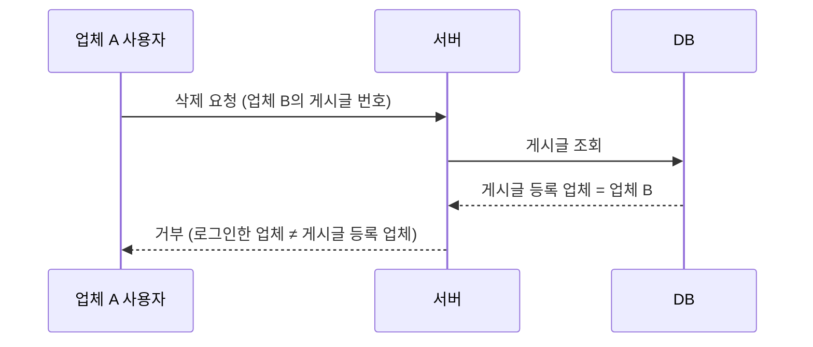

> 이 글은 2023~2024년에 수행한 작업을 퇴사 후 정리한 기록입니다. 코드는 실제 소스가 아니라 원리를 설명하기 위해 새로 작성한 예시입니다.

## 1. 들어가며

저는 대형 통신사가 운영하는 서비스 두 곳에서 관리자 사이트와 API를 개발한 백엔드 개발자였습니다. 이 글에서는 두 서비스를 이렇게 부르겠습니다.

- **서비스 A**: 여러 콘텐츠 제공사가 로그인해 자기 콘텐츠를 등록하고 관리하는 관리자 사이트
- **서비스 B**: 3D 공간 콘텐츠를 만드는 개발사가 로그인해 콘텐츠를 등록하는 관리자 사이트

두 서비스 모두 **여러 회사가 한 사이트를 함께 씁니다.** 회사마다 자기 데이터만 보고 고칠 수 있어야 합니다.

두 서비스는 배포 전에 통신사의 보안검증을 통과해야 했고, 통과하지 못하면 배포할 수 없었습니다. 보안검증에는 모의해킹도 포함됩니다. 모의해킹은 보안 전문가가 실제 공격자처럼 서비스를 공격해 보고, 뚫린 곳을 보고서로 알려주는 진단입니다.

저는 2023~2024년에 이 진단에서 나온 지적을 직접 조치했습니다. 이 기간 제 커밋 129건 중 22건이 보안 조치였습니다. 이 글에서는 그중 세 건을 다룹니다. 시기도 서비스도 달랐지만, 돌아보니 원인이 같았습니다.

## 2. 세 번의 지적

| 시기 | 서비스 | 지적 |
| --- | --- | --- |
| 2023년 5월 | 서비스 A | 다른 업체의 게시글 삭제, 다른 업체 사용자 삭제·탈퇴 가능 |
| 2024년 1월 | 서비스 B | 아이디 중복확인으로 가입된 아이디 확인 가능 |
| 2024년 3월 | 서비스 B | 파일 다운로드 경로 조작 |

### 다른 업체의 게시글이 지워졌습니다

게시글을 삭제하면 브라우저는 서버에 "이 번호의 게시글을 지워 주세요"라는 요청을 보냅니다. 서비스 A의 서버는 이 번호만 보고 게시글을 지웠습니다. 요청한 사람이 그 게시글의 주인인지는 확인하지 않았습니다.

그래서 로그인한 업체가 요청 안의 게시글 번호만 바꾸면, 다른 업체의 게시글이 지워졌습니다. 같은 진단에서 사용자 관리 기능도 지적됐습니다. 다른 업체의 사용자를 삭제하거나 탈퇴시킬 수 있었습니다. 여러 회사가 함께 쓰는 사이트에서 가장 피해야 할 문제였습니다.

### "이미 사용 중인 아이디입니다"가 정보가 됐습니다

회원가입 화면에서 아이디 중복확인 버튼을 누르면 "이미 사용 중인 아이디입니다"라는 메시지를 볼 수 있습니다. 사용자에게는 친절한 안내지만, 공격자에게는 "이 아이디는 실제로 존재한다"는 답입니다.

서비스 B의 중복확인은 호출 횟수에 제한이 없었습니다. 아이디 목록을 넣어 반복 호출하면 가입된 아이디를 골라낼 수 있었습니다. 이렇게 존재하는 계정을 알아내는 공격을 계정 열거라고 합니다. 알아낸 아이디는 비밀번호 대입 공격의 출발점이 됩니다.

### 서버의 다른 파일을 내려받을 수 있었습니다

서비스 B의 파일 다운로드 기능은 요청에 담긴 파일 경로를 그대로 사용했습니다. 이 경로를 바꾸면, 사용자에게 내려주면 안 되는 서버의 다른 파일에도 접근할 수 있는 구조였습니다. 진단에서 중대 취약점으로 분류됐습니다.

## 3. 화면에서 막고, 필터로 막았지만

### 클라이언트에서 막는 것으로는 부족했습니다

계정 열거 지적에는 두 가지 조치 방안을 검토했습니다.

| 방안 | 내용 | 특징 |
| --- | --- | --- |
| 클라이언트 측 제한 | 브라우저에서 중복확인 버튼 클릭 횟수 제한 | 구현이 간단함 |
| 서버 측 제한 | 같은 IP의 요청 횟수를 세어 초과 시 차단 | 요청 이력을 저장할 테이블 필요 |

클라이언트 측 제한은 버튼을 누르는 사람만 막습니다. 공격자는 화면을 거치지 않고 서버에 요청을 직접 보냅니다. 그래서 서버 측 제한을 골랐습니다. 게시글 삭제도 마찬가지입니다. 다른 업체 게시글의 삭제 버튼을 화면에서 숨겨도, 요청은 직접 보낼 수 있습니다.

### 필터는 이미 있었습니다

서비스 B에는 엑셀 양식을 내려받는 기능이 있었고, 이 기능에는 경로 조작을 막는 필터가 이미 있었습니다. 경로에 쓰이는 문자(`/`, `\`, `.`)를 지우는 코드입니다. 2023년 11월, 팀원이 정적분석 결과를 조치하면서 넣었습니다. 정적분석은 코드를 실행하지 않고 위험한 패턴을 찾아주는 도구입니다.

그런데 이 필터에는 정규식 오류가 있었고, 같은 날 제가 고쳤습니다.

```java
// 필터 (예시)
fileName = fileName.replaceAll(".", "");   // 정규식 . 은 "모든 문자" → 파일명 전체가 지워짐
fileName = fileName.replaceAll("\\", "");  // 정규식 \ 하나 → PatternSyntaxException

// 수정: 정규식 특수문자를 이스케이프
fileName = fileName.replaceAll("\\.", "");
fileName = fileName.replaceAll("\\\\", "");
```

`replaceAll()`은 이름과 달리 문자열이 아니라 정규식을 받습니다. 점 하나를 지우려던 코드가 파일명 전체를 지우고 있었습니다. 필터는 한 줄짜리 코드도 이렇게 틀리기 쉽습니다.

4개월 뒤인 2024년 3월, 모의해킹에서 경로 조작이 지적됐습니다. 지적된 곳은 엑셀 양식 다운로드가 아니라, 같은 코드 파일에 있는 일반 파일 다운로드 기능이었습니다. 이 기능은 요청에 경로가 들어오면 그 경로를 그대로 사용했고, 필터를 거치지 않았습니다. 한쪽 문은 잠가 두었는데 바로 옆 문에는 처음부터 잠금장치가 없었던 셈입니다.

필터로 막으려면 경로를 받는 모든 입구에 필터를 빠짐없이 달아야 합니다. 입구가 늘어날 때마다 같은 일을 반복해야 하고, 하나만 놓쳐도 뚫립니다.

## 4. 서버가 그대로 믿은 값

무엇이 뚫렸는지는 진단 보고서에 나와 있었습니다. 제가 한 일은 보고서의 내용을 코드에서 따라가는 것이었습니다.

1. 보고서에 적힌 공격 요청을 확인합니다.
2. 그 요청의 값이 서버 코드 어디에서 쓰이는지 추적합니다.
3. 같은 방식으로 값을 쓰는 코드를 소스 전체에서 찾습니다.
4. 찾은 곳을 함께 수정합니다.

세 건을 나란히 놓으면 공통점이 보입니다. 서버가 클라이언트가 보낸 값을 확인 없이 그대로 믿었습니다.

| 지적 | 서버가 그대로 믿은 값 |
| --- | --- |
| 다른 업체 게시글 삭제 (권한 검증 누락) | 요청에 담긴 게시글 번호 |
| 계정 열거 | 아이디 확인 요청 횟수 (제한 없이 모두 응답) |
| 경로 조작 | 요청에 담긴 파일 경로 |

## 5. 서버가 직접 확인하도록 고쳤습니다

세 건 모두 아래처럼 고쳐 재검증을 통과했고, 상용에 반영했습니다. 지적받은 곳 외에 같은 방식으로 값을 쓰는 코드도 전수조사해 함께 고쳤습니다.

### 5-1. 게시글 삭제: 요청한 업체가 주인인지 확인합니다

```java
// 조치 전: 요청으로 받은 postId만으로 삭제
public void deletePost(Long postId) {
    postRepository.deleteById(postId);
}

// 조치 후: 로그인한 업체와 게시글을 등록한 업체를 비교한 뒤 삭제
public void deletePost(Long postId, Long loginCompanyId) {
    Post post = postRepository.findById(postId)
            .orElseThrow(NotFoundException::new);

    if(!post.getCompanyId().equals(loginCompanyId)) {
        throw new AccessDeniedException("삭제 권한 없음");
    }

    postRepository.delete(post);
}
```

"로그인한 업체"는 요청에 담긴 값이 아니라, 로그인할 때 서버가 저장해 둔 값(세션)에서 꺼냅니다. 클라이언트가 바꿀 수 없는 값으로 비교해야 의미가 있습니다.



사용자 삭제·탈퇴도 같은 방식으로 고쳤습니다.

### 5-2. 계정 열거: 서버에서 횟수를 셉니다

중복확인 요청이 올 때마다 요청한 IP와 결과를 이력 테이블에 기록했습니다. 같은 IP에서 최근 10분 동안 10번 이상 요청하면, 그 IP를 60분 동안 차단했습니다.

```java
private boolean isBlocked(String clientIp) {
    if(blockRepository.existsActiveBlock(clientIp)) {
        return true;                          // 이미 차단 중인 IP
    }

    // 같은 IP의 최근 10분 중복확인 요청 수
    long count = historyRepository.countByIpSince(
            clientIp, LocalDateTime.now().minusMinutes(10));

    if(count >= 10) {
        blockRepository.save(IpBlock.of(clientIp, 60));   // 60분 차단
        return true;
    }
    return false;
}
```

차단 여부는 아이디를 조회하기 전에 판단합니다. 차단된 요청도 이력에 남겨, 어떤 IP가 얼마나 시도했는지 추적할 수 있게 했습니다.

### 5-3. 경로 조작: 경로를 받지 않습니다

선택지는 두 가지였습니다. 필터를 다운로드 기능에도 다는 것과, 경로를 받는 갈래 자체를 없애는 것입니다. 저는 갈래를 없앴습니다. 파일 정보는 업로드할 때 이미 DB에 번호(시퀀스)로 저장되고 있었습니다. 클라이언트가 경로를 보낼 이유가 없었습니다.

```java
// 조치 전 (예시): 경로가 들어오면 그대로 사용
String path = params.get("path");

if(StringUtils.isNotBlank(path)) {
    filePath = path;                          // 클라이언트가 보낸 경로
}else {
    FileInfo file = findLinkedFile(params);
    filePath = file.getPath();
}

// 조치 후: 파일 번호로 조회하는 방식만 남김
FileInfo file = findLinkedFile(params);       // 요청한 게시글에 연결된 파일인지 확인
if(file == null) {
    return ResponseEntity.notFound().build();
}
filePath = file.getPath();                    // 서버가 저장해 둔 경로
```

필터는 "막아야 할 입력"의 목록입니다. 목록에서 하나만 빠져도 뚫립니다. 번호 조회는 "내려줄 수 있는 파일"의 목록입니다. 목록에 없는 파일은 처음부터 요청할 방법이 없습니다.

## 6. 한계와 지금 다시 한다면

### 1년 뒤, 같은 지적을 또 받았습니다

2024년 9월, 서비스 B의 보안검증에서 "다른 사람의 게시물을 수정할 수 있다"는 지적이 나왔습니다. 1년 전 서비스 A에서 받은 지적과 같은 유형이었습니다. 이때도 수정 기능에 주인 확인 코드를 넣어 같은 방식으로 조치했습니다.

같은 지적이 반복된 이유는 조치 방식에 있었다고 생각합니다. 기능마다 확인 코드를 직접 넣는 방식은 새 기능을 만들 때 빠뜨리기 쉽습니다.

지금이라면 게시글을 조회하는 쿼리 자체에 "로그인한 업체의 것만"이라는 조건을 넣겠습니다. 그러면 개발자가 확인 코드를 빠뜨려도, 다른 업체의 게시글은 애초에 조회되지 않습니다.

### 차단 기준인 IP도 클라이언트가 보낸 값이었습니다

5-2의 차단은 요청한 사람의 IP를 기준으로 합니다. 그런데 IP를 구하는 코드는 요청 헤더(`X-Forwarded-For`)를 먼저 읽고, 헤더가 없을 때만 실제 접속 주소를 썼습니다. 이 헤더는 중간 서버(프록시)가 원래 접속자의 IP를 전달할 때 쓰는 값인데, 클라이언트도 마음대로 넣을 수 있습니다.

앞단 서버가 이 헤더를 덮어쓰지 않는 구성이었다면, 코드만 보면 헤더 값을 바꿔 가며 횟수 제한을 피할 수 있습니다. 당시 인프라 구성까지는 확인하지 못했습니다.

이 글의 결론이 "클라이언트 값을 믿지 않는다"인데, 조치 코드에도 같은 문제가 남아 있었던 셈입니다. 지금이라면 신뢰할 수 있는 중간 서버를 지정하고, 그 서버가 붙인 헤더만 인정하도록 설정하겠습니다. IP 기준 차단의 다른 한계는 요청 횟수 제한을 다루는 글에서 이어서 정리하겠습니다.

## 7. 정리

세 건의 지적은 모두 서버가 클라이언트가 보낸 값을 믿어서 생겼습니다. 게시글 번호도, 파일 경로도 클라이언트가 바꿀 수 있는 값이었습니다. 조치에 쓴 IP도 마찬가지였습니다. 저는 서버가 스스로 알 수 있는 값은 클라이언트에게 받지 않는 것이 가장 확실한 방어라고 생각합니다.
