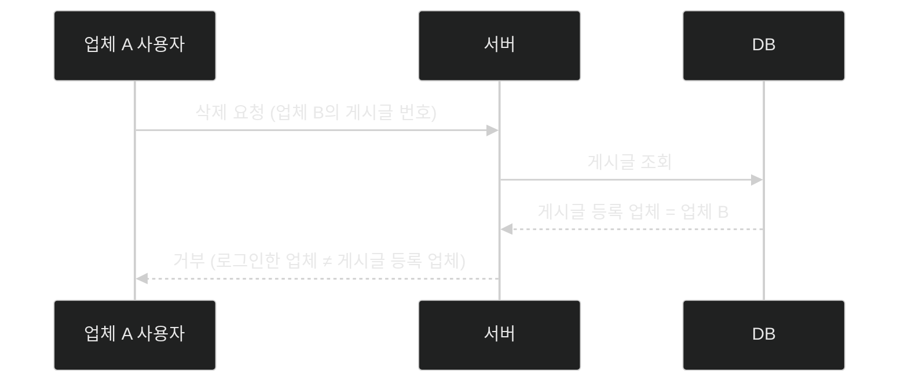

> 2023~2024년 작업을 퇴사 후 정리한 글입니다. 코드는 실제 소스가 아닌 설명용 예시입니다.

## 1. 들어가며

이 글은 대형 통신사 보안검증(모의해킹)에서 지적된 취약점 세 가지를 분석하고 직접 조치한 기록입니다. 다룰 서비스는 두 곳입니다. 

- **서비스 A**: 여러 콘텐츠 제공사가 로그인해 자기 콘텐츠를 등록하고 관리하는 관리자 사이트
- **서비스 B**: 3D 공간 콘텐츠를 만드는 개발사가 로그인해 콘텐츠를 등록하는 관리자 사이트

두 서비스 모두 **여러 회사가 한 사이트를 함께 쓰기 때문에**, 회사마다 자기 데이터만 보고 고칠 수 있어야 합니다. 또한, 두 서비스는 배포 전에 통신사의 보안검증을 통과해야 했습니다. 보안검증에는 보안 전문가가 공격자처럼 서비스를 공격해 보는 모의해킹이 포함됩니다.

저는 2023~2024년에 위 진단에서 나온 취약점을 직접 조치했고, 이 기간 내 제 커밋 129건 중 22건은 보안 조치였습니다. 이 글에서는 그중 세 건을 다룹니다.

## 2. 지적받은 취약점 세 가지

| 시기 | 서비스 | 지적 |
| --- | --- | --- |
| 2023년 5월 | 서비스 A | 다른 업체의 게시글 삭제, 다른 업체 사용자 삭제·탈퇴 가능 |
| 2024년 1월 | 서비스 B | 아이디 중복확인으로 가입된 아이디 확인 가능 |
| 2024년 3월 | 서비스 B | 파일 다운로드 경로 조작 |

### 권한 검증이 없어 다른 업체 글이 지워졌습니다

게시글을 삭제하면 브라우저는 서버에 "이 번호의 게시글을 지워 주세요"라는 요청을 보냅니다. 그런데 서비스 A의 서버는 이 번호만 보고 게시글을 지웠을 뿐, 요청한 사람이 그 게시글의 주인인지는 확인하지 않았습니다.

그래서 로그인한 업체가 요청 안의 게시글 번호만 바꾸면 다른 업체의 게시글이 지워졌습니다. 같은 진단에서는 사용자 관리 기능도 지적됐는데, 다른 업체의 사용자를 삭제하거나 탈퇴시킬 수 있었습니다. 여러 회사가 함께 쓰는 사이트에서 가장 피해야 할 문제였습니다.

### 중복확인 API로 계정 열거가 가능했습니다

회원가입 화면에서 아이디 중복확인 버튼을 누르면 "이미 사용 중인 아이디입니다"라는 메시지를 볼 수 있습니다. 사용자에게는 친절한 안내지만, 공격자에게는 "이 아이디는 실제로 존재한다"는 답입니다.

서비스 B의 중복확인은 호출 횟수에 제한이 없어서, 아이디 목록을 넣어 반복 호출하면 가입된 아이디를 골라낼 수 있었습니다. 이렇게 존재하는 계정을 알아내는 공격을 계정 열거라고 합니다. 알아낸 아이디는 비밀번호 대입 공격의 출발점이 됩니다.

### 다운로드 경로를 조작해 서버 파일에 접근할 수 있었습니다

서비스 B의 파일 다운로드 기능은 요청에 담긴 파일 경로를 그대로 사용했습니다. 이 경로를 바꾸면 사용자에게 내려주면 안 되는 서버의 다른 파일에도 접근할 수 있었고, 진단에서는 중대 취약점으로 분류됐습니다.

## 3. 화면이나 필터로 막으면 안 될까?

### 화면 제한은 우회할 수 있어 서버 조치를 택했습니다

계정 열거 지적에는 두 가지 조치 방안을 검토했습니다.

| 방안 | 내용 | 특징 |
| --- | --- | --- |
| 클라이언트 측 제한 | 브라우저에서 중복확인 버튼 클릭 횟수 제한 | 구현이 간단함 |
| 서버 측 제한 | 같은 IP의 요청 횟수를 세어 초과 시 차단 | 요청 이력을 저장할 테이블 필요 |

클라이언트 측 제한은 버튼을 누르는 사람만 막을 뿐, 화면을 거치지 않고 서버에 요청을 직접 보내는 공격자는 막지 못합니다. 그래서 서버 측 제한을 골랐습니다. 게시글 삭제도 마찬가지여서, 다른 업체 게시글의 삭제 버튼을 화면에서 숨겨도 요청은 직접 보낼 수 있습니다.

### 엑셀 양식 다운로드에만 필터가 있었습니다

서비스 B에는 엑셀 양식을 내려받는 기능이 있었고, 이 기능에는 경로에 쓰이는 문자(`\`, `.`)를 지우는 필터가 이미 있었습니다. 그런데 2024년 3월 모의해킹에서 경로 조작이 지적된 곳은 같은 코드 파일에 있는 일반 파일 다운로드 기능이었는데, 이 기능은 요청에 경로가 들어오면 필터를 거치지 않고 그 경로를 그대로 사용했습니다. 한쪽 문은 잠가 두었는데 바로 옆 문에는 처음부터 잠금장치가 없었던 셈입니다.

필터로 막으려면 경로를 받는 모든 입구에 필터를 빠짐없이 달아야 합니다. 입구가 늘어날 때마다 같은 일을 반복해야 하고, 하나만 놓쳐도 뚫립니다.

## 4. 세 건의 공통 원인

세 건을 나란히 놓으면 공통점이 보입니다. 서버가 클라이언트에서 온 값을 확인 없이 그대로 믿었습니다.

| 지적 | 서버가 그대로 믿은 값 |
| --- | --- |
| 다른 업체 게시글 삭제 (권한 검증 누락) | 요청에 담긴 게시글 번호 |
| 계정 열거 | 아이디 확인 요청 횟수 (제한 없이 모두 응답) |
| 경로 조작 | 요청에 담긴 파일 경로 |

## 5. 서버에서 다시 확인하기

세 건 모두 수정해 재검증을 통과했고, 상용에 반영했습니다.

### 요청한 업체와 등록 업체를 비교해 권한을 검증했습니다

```java
// 조치 전 (예시): 요청으로 받은 postId만으로 삭제
public void deletePost(Long postId) {
    postRepository.deleteById(postId);
}

// 조치 후: 로그인한 업체와 게시글을 등록한 업체를 비교한 뒤 삭제
public void deletePost(Long postId, Long loginCompanyId) {
    Post post = postRepository.findById(postId)
            .orElseThrow(NotFoundException::new);

    if(!post.getCompanyId().equals(loginCompanyId)) {
        throw new AccessDeniedException("삭제 권한 없음");
    }

    postRepository.delete(post);
}
```

"로그인한 업체"는 요청에 담긴 값이 아니라, 로그인할 때 서버가 저장해 둔 값(세션)에서 꺼냅니다. 클라이언트가 바꿀 수 없는 값으로 비교해야 의미가 있습니다.



사용자 삭제·탈퇴도 같은 방식으로 고쳤습니다.

### 서버 측 횟수 제한으로 계정 열거를 막았습니다

중복확인 요청이 올 때마다 요청한 IP와 결과를 이력 테이블에 기록하고, 같은 IP에서 최근 10분 동안 10번 이상 요청하면 그 IP를 60분 동안 차단했습니다.

```java
// IP 차단 여부 판단 (예시)
private boolean isBlocked(String clientIp) {
    if(blockRepository.existsActiveBlock(clientIp)) {
        return true;                                      // 이미 차단 중인 IP
    }

    // 같은 IP의 최근 10분 중복확인 요청 수
    long count = historyRepository.countByIpSince(
            clientIp, LocalDateTime.now().minusMinutes(10));

    if(count >= 10) {
        blockRepository.save(IpBlock.of(clientIp, 60));   // 60분 차단
        return true;
    }
    return false;
}
```

차단 여부는 아이디를 조회하기 전에 판단합니다. 차단된 요청도 이력에 남겨, 어떤 IP가 얼마나 시도했는지 추적할 수 있게 했습니다.

### 경로 대신 파일 번호를 받아 경로 조작을 막았습니다

선택지는 다운로드 기능에도 필터를 다는 것과 경로를 받는 갈래 자체를 없애는 것 두 가지였습니다. 파일 정보는 업로드할 때 이미 DB에 번호(시퀀스)로 저장되고 있어서 클라이언트가 경로를 보낼 이유가 없었습니다. 저는 경로를 받는 갈래를 없애는 선택을 했습니다.

```java
// 조치 전 (예시): 경로가 들어오면 그대로 사용
String path = params.get("path");

if(StringUtils.isNotBlank(path)) {
    filePath = path;                          // 클라이언트가 보낸 경로
}else {
    FileInfo file = findLinkedFile(params);
    filePath = file.getPath();
}

// 조치 후: 파일 번호로 조회하는 방식만 남김
FileInfo file = findLinkedFile(params);       // 요청한 게시글에 연결된 파일인지 확인
if(file == null) {
    return ResponseEntity.notFound().build();
}
filePath = file.getPath();                    // 서버가 저장해 둔 경로
```

필터는 "막아야 할 입력"의 목록이라 하나만 빠져도 뚫립니다. 반면 번호 조회는 "내려줄 수 있는 파일"의 목록이어서, 목록에 없는 파일은 처음부터 요청할 방법이 없습니다.

## 6. 한계와 지금 다시 한다면

### 1년 뒤 같은 권한 검증 지적을 또 받았습니다

2024년 9월 보안검증에서는 서비스 B를 포함한 서비스 전체에 22개 조치 항목이 나왔습니다. 서비스 B에서 나온 "다른 사람의 게시물을 수정할 수 있다"는 지적은 1년 전 서비스 A에서 받은 지적과 같은 유형이었습니다. 이때도 수정 기능에 주인 확인 코드를 넣어 같은 방식으로 조치했습니다.

저는 같은 지적이 반복된 이유가 조치 방식에 있었다고 생각합니다. 기능마다 확인 코드를 직접 넣는 방식은 새 기능을 만들 때 빠뜨리기 쉽기 때문입니다.

지금이라면 게시글을 조회하는 쿼리 자체에 "로그인한 업체의 것만"이라는 조건을 넣겠습니다. 그러면 개발자가 확인 코드를 빠뜨려도, 다른 업체의 게시글은 애초에 조회되지 않습니다.

### 차단 기준인 IP도 클라이언트가 바꿀 수 있는 값이었습니다

5장의 차단은 요청한 사람의 IP를 기준으로 합니다. 그런데 IP를 구하는 코드는 요청 헤더(`X-Forwarded-For`)를 먼저 읽고, 헤더가 없을 때만 실제 접속 주소를 썼습니다. 이 헤더는 중간 서버(프록시)가 원래 접속자의 IP를 전달할 때 쓰는 값인데, 클라이언트도 마음대로 넣을 수 있습니다.

코드만 놓고 보면, 앞단 서버가 이 헤더를 덮어쓰지 않는 구성에서는 헤더 값을 바꿔 가며 횟수 제한을 피할 수 있었습니다. 다만 당시 인프라 구성까지는 확인하지 못했습니다.

이 글의 결론이 "클라이언트 값을 믿지 않는다"인데, 조치 코드에도 같은 문제가 남아 있었던 셈입니다. 지금이라면 신뢰할 수 있는 중간 서버를 지정하고, 그 서버가 붙인 헤더만 인정하도록 설정하겠습니다. IP 기준 차단의 다른 한계는 요청 횟수 제한을 다루는 글에서 이어서 정리하겠습니다.

## 7. 정리

세 건 모두 서버가 직접 확인하도록 고쳐 재검증을 통과했고, 같은 방식으로 값을 쓰는 코드도 찾아 함께 고쳤습니다.

세 건의 지적은 모두 서버가 클라이언트에서 온 값을 믿어서 생겼습니다. 게시글 번호도, 파일 경로도, 조치에 쓴 IP까지도 클라이언트가 바꿀 수 있는 값이었습니다. 저는 서버가 스스로 알 수 있는 값은 클라이언트에게 받지 않는 것이 가장 확실한 방어라고 생각합니다.
