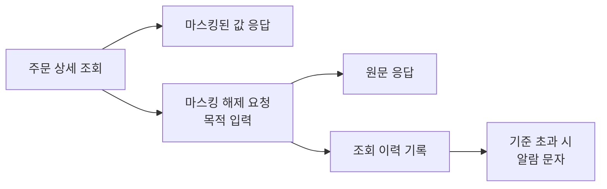

> 이 글은 2024년에 수행한 작업을 퇴사 후 정리한 기록입니다. 코드는 실제 소스가 아니라 원리를 설명하기 위해 새로 작성한 예시입니다.

## 1. 들어가며

저는 대형 통신사가 운영하는 서비스의 관리자 사이트와 API를 개발한 백엔드 개발자였습니다. 관리자 사이트의 커머스 기능과 보안 조치를 주로 맡았습니다.

[보안검증 #1](/posts/untrusted-client-input/)에서 서비스 B라고 부른 관리자 사이트에는 커머스 관리 기능도 있었습니다. 입점 브랜드의 상품 주문이 들어오면, 이 사이트에서 주문자와 수령인의 이름, 연락처, 주소를 보고 배송을 처리합니다.

이 글은 2024년 4~5월, 주문 화면의 고객 정보를 가리면서도 배송 업무가 멈추지 않도록 바꾼 과정입니다. 고객 정보를 `홍*동`처럼 일부 가려 보여주는 것을 마스킹, 업무상 필요할 때 가리지 않은 원문을 꺼내 보는 것을 마스킹 해제라고 부르겠습니다.

## 2. 배송에는 원문이, 보안검증에는 마스킹이 필요했습니다

배송을 처리하려면 수령인의 실제 이름과 연락처가 필요합니다. 화면에 `홍*동`, `010-****-5678`만 보이면 택배를 보낼 수 없습니다. 그래서 배송을 처리하는 운영 쪽에서 원문을 볼 수 있게 해 달라는 요청이 왔습니다.

반대로 통신사 보안검증에서는 주문 상세 화면이 지적됐습니다. 개인정보가 기본으로 노출되고, 원문을 본 사유가 기록되지 않는다는 내용이었습니다.

단순한 답은 두 가지입니다.

- **항상 가린다**: 보안검증은 통과하지만 배송 담당자가 일을 할 수 없습니다.
- **항상 보여준다**: 일은 되지만 개인정보가 화면을 연 모든 사람에게 노출됩니다.

두 요구 모두 맞았습니다. 그래서 질문을 바꿔야 했습니다. "보여줄까, 말까"가 아니라 "기본은 가리고, 꺼내 볼 때는 무엇을 남길까"였습니다.

## 3. 기본은 가리고, 꺼내 볼 때는 남깁니다

세 가지 원칙으로 구조를 정했습니다.

1. **기본은 마스킹입니다.** 원문은 마스킹 해제를 요청했을 때만 응답합니다.
2. **마스킹은 서버가 합니다.** 마스킹을 해제하지 않으면 응답에 원문이 아예 들어가지 않습니다.
3. **마스킹을 해제하면 남깁니다.** 마스킹 해제 목적과 조회 이력을 기록하고, 이상한 조회는 접속기록 시스템의 알람으로 확인합니다.

1번과 3번은 보안검증의 지적 항목에 대응합니다. 2번은 지적 항목에 없던 문제를 제가 찾아 넣은 원칙입니다.

처음 만든 구조는 서버가 원문을 응답하고, 화면의 버튼으로 가리는 방식이었습니다. 화면에는 `홍*동`이 보여도, 브라우저 개발자 도구를 열면 응답 안의 `홍길동`이 보입니다. 상세 화면을 연 모든 관리자가 원문을 받는 셈이라, 누가 원문을 봤는지 기록할 수도 없습니다. 저는 응답에 원문이 들어 있는 한 화면에서 가리는 것은 의미가 없다고 판단했고, 마스킹 위치를 서버로 옮겼습니다. 지적받은 기본 노출만 고쳤다면, 화면의 기본값만 "가림"으로 바꾸고 끝낼 수도 있었습니다.



배송 담당자는 여전히 원문을 볼 수 있습니다. 대신 마스킹을 해제할 때마다 목적을 입력해야 하고, 원문을 본 기록이 남습니다.

## 4. 서버에서 가리고, 마스킹을 해제할 때만 꺼내 줍니다

### 4-1. 원문은 마스킹 해제 요청에만 내려줍니다

서버는 마스킹 해제 요청이 아니면 마스킹된 값만 응답합니다. 마스킹 해제 요청일 때만 원문을 응답하고, 그때 조회 이력을 남깁니다.

```java
// 주문 상세 조회 (예시)
public OrderDetail findDetail(Long orderId, boolean unmask, AdminUser admin) {
    Order order = orderRepository.findById(orderId)
            .orElseThrow(() -> new OrderNotFoundException(orderId));

    if(!unmask) {
        return OrderDetail.masked(order);   // 기본: 서버에서 가린 값만 응답
    }

    accessLogClient.send(AccessLog.view(admin, order.getId()));
    return OrderDetail.original(order);
}
```

주문 목록에서는 이름과 연락처 열을 아예 뺐습니다. 목록은 주문을 찾는 화면이고, 배송에 필요한 정보는 상세에서 마스킹을 해제해 보면 되기 때문입니다.

### 4-2. 마스킹을 해제할 때는 목적을 입력합니다

상세 화면의 탭마다 마스킹 설정 팝업을 두었습니다. 마스킹 해제를 선택하면 목적을 입력해야 합니다.

입력한 목적은 화면 구분, IP, 관리자 ID, 시각과 함께 서비스 DB에 저장했습니다. 나중에 "누가, 언제, 어느 화면에서, 왜 봤는지"를 확인할 수 있습니다.

### 4-3. 엑셀 다운로드에도 같은 규칙을 적용했습니다

주문 정보는 상세 화면 말고도 엑셀로 내려받을 수 있었습니다. 상세 화면에서 고객의 이름, 연락처, 주소를 가려도 내려받은 파일에 원문이 그대로 담기면 가린 의미가 없습니다. 그래서 엑셀 다운로드에도 상세 화면과 같은 규칙을 적용했습니다.

엑셀을 내려받을 때 마스킹 여부를 선택하게 했습니다. 기본은 마스킹이고, 마스킹 해제를 고르면 원문이 담기며 조회 이력에 다운로드로 기록됩니다. 필요한 컬럼만 골라 받는 기능도 함께 넣었습니다.

## 5. 남긴 기록은 알람으로 확인했습니다

### 5-1. 조회 이력

서비스 B는 개인정보보호법상 접속기록 의무에 맞춰 통신사의 개인정보 접속기록 시스템과 연동돼 있었습니다. 이 글에서는 이 기록을 조회 이력이라고 부르겠습니다. 최초 연동은 선임 개발자가 했습니다. 저는 주문·배송·취소 조회와 엑셀 다운로드까지 기록 범위를 넓혔습니다. 조회인지 다운로드인지, 누구의 정보인지를 이벤트로 보냅니다.

작업 중에는 기록 자체의 오류도 고쳤습니다. 상세 조회 이력의 수령인 이름 자리에 전화번호가 들어가고 있었습니다. 기록이 남아도 내용이 틀리면 확인할 수 없습니다.

### 5-2. 이상 조회 알람

접속기록 시스템은 기준을 넘는 조회가 쌓이면 담당자에게 알람 문자를 보냅니다. 저는 이 서비스의 알람 수신 담당이었습니다. 예를 들어 1시간 동안 개인정보 조회 시도가 30건 이상이면 과다 조회 알람이 옵니다.

알람 문자를 받으면 업무시간 기준 30분 안에 정탐인지 오탐인지 등록해야 했습니다. 정탐은 실제로 확인이 필요한 조회, 오탐은 정상 업무가 기준에 걸린 경우입니다.

당시 개인정보 보호 기준에는 접속기록을 월 1회 이상 점검하라는 요구가 있었습니다. 한 달에 한 번 기록을 모아 보면, 이상한 조회를 최대 한 달 뒤에야 발견합니다. 알람은 기준을 넘는 조회가 생긴 그때 담당자에게 알려 줍니다. 저는 알람을 이 점검을 한 달 뒤가 아니라 바로 하게 만드는 장치라고 이해했습니다.

## 6. 한계와 지금 다시 한다면

### 처음에는 화면에서 가렸습니다

운영 요청을 받고 처음 만든 구조는 3장에서 설명한 대로 화면에서 가리는 방식이었습니다. 이 구조가 보안검증에서 기본 노출로 지적을 받아, 3장의 구조로 바꾸기까지 1주가 더 걸렸습니다.

처음부터 응답 데이터를 확인했다면 한 번에 끝낼 수 있었던 작업입니다. 지금이라면 개인정보 화면을 바꿀 때 응답 데이터부터 확인하겠습니다.

### 마스킹 해제 목적과 조회 이력이 다른 곳에 있었습니다

관리자가 입력한 목적은 서비스 DB에 저장됐습니다. 접속기록 시스템에는 "주문 정보 조회"처럼 조회 종류별로 정해진 문구가 갔습니다. 알람을 판정할 때 실제 목적을 보려면 두 곳을 맞춰 봐야 하는 구조입니다. 지금이라면 입력한 목적을 조회 이력 이벤트에 함께 담겠습니다.

## 7. 정리

배송에는 원문이 필요했고, 보안검증은 기본 노출을 지적했습니다. 어느 한쪽을 포기하지 않고, 서버에서 기본으로 가리고 마스킹을 해제할 때만 원문을 내주며 그 기록을 남기는 구조로 두 요구를 함께 맞추었습니다. 이 과정에서 화면에서만 가리는 것은 가린 것이 아니라는 점도 배웠습니다.

저는 개인정보 보호가 업무를 막는 것이 아니라, 필요한 열람을 기록이 남는 길로 보내는 일이라고 생각합니다.
