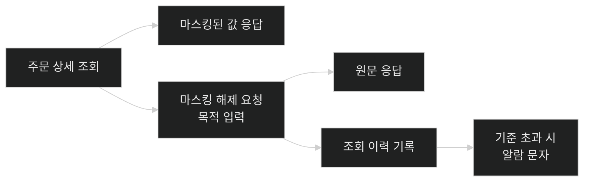

> 2024년 작업을 퇴사 후 정리한 글입니다. 코드는 실제 소스가 아닌 설명용 예시입니다.

## 1. 들어가며

이 글은 커머스 관리자 사이트의 고객 정보를 서버에서 마스킹하고, 마스킹 해제 기록을 남기며 접속기록 알람에 대응한 과정입니다.

관리자 사이트에는 입점 브랜드의 상품을 파는 커머스 관리 기능이 있었고, 주문이 들어오면 운영자는 여기서 주문자와 수령인의 이름, 연락처, 주소를 보고 배송을 처리합니다.

2024년 4~5월, 주문 화면에 보이는 고객 개인정보를 보호하면서도 배송 업무가 멈추지 않도록 하는 작업을 진행했습니다. 앞으로 고객 정보를 `홍*동`처럼 일부 가려 보여주는 것을 마스킹, 업무상 필요할 때 가리지 않은 원문을 꺼내 보는 것을 마스킹 해제라고 부르겠습니다.

## 2. 원문이 필요한 배송, 가리라는 보안검증

배송을 처리하려면 수령인의 실제 이름과 연락처가 필요합니다. 화면에 `홍*동`, `010-****-5678`만 보이면 택배를 보낼 수 없습니다. 그래서 배송을 처리하는 운영 쪽에서 원문을 볼 수 있게 해야 했습니다.

반대로 통신사 보안검증에서는 주문 상세 화면에 고객의 개인정보가 기본으로 노출되고 있다고 지적했습니다. 고객의 개인정보는 보호되어야 하며, 불가피한 경우 개인정보 조회 사유를 기록으로 남겨야 한다는 내용이었습니다.

- **항상 가린다**: 보안검증은 통과하지만 배송 담당자가 일을 할 수 없습니다.
- **항상 보여준다**: 업무는 가능하지만 개인정보가 화면을 연 모든 사람에게 노출됩니다.

두 요구 모두 맞았습니다. 그래서 질문을 "보여줄까, 말까"에서 "기본은 가리되, 꺼내 볼 때는 무엇을 남길까"로 바꿨습니다.

## 3. 기본은 가리고, 볼 때는 기록하기

세 가지 원칙으로 구조를 정했습니다.

1. **기본은 마스킹입니다.** 원문은 마스킹 해제를 요청했을 때만 응답합니다.
2. **마스킹은 서버가 합니다.** 마스킹을 해제하지 않으면 응답에 원문이 아예 들어가지 않습니다.
3. **마스킹을 해제하면 기록합니다.** 마스킹 해제 목적과 누가 언제 조회했는지를 남기고, 이상한 조회는 접속기록 시스템의 알람으로 확인합니다.

처음 만든 구조는 서버가 원문을 응답하고, 화면에서 가리는 방식이었습니다. 화면에는 `홍*동`이 보여도, 브라우저 개발자 도구를 열면 응답 안의 `홍길동`이 보입니다. 결국 모든 관리자가 원문을 받는 셈이라, 해제 기록을 남겨도 소용이 없었습니다. 저는 **응답에 원문이 들어 있는 한 화면에서 가리는 것은 의미가 없다**고 판단했고, 마스킹 처리 위치를 서버로 옮겼습니다.



배송 담당자는 여전히 원문을 볼 수 있습니다. 변경된 점은 마스킹을 해제할 때마다 목적을 입력해야 하고, 해제를 요청한 기록이 남았다는 것입니다.

## 4. 서버 마스킹과 해제 기록 구현

### 원문은 마스킹 해제 요청에만 내려줍니다

서버는 마스킹 해제 요청이 아니면 마스킹된 값만 응답합니다. 마스킹 해제 요청일 때만 원문을 응답하고, 그때 접속기록을 남깁니다.

```java
// 주문 상세 조회 (예시)
public OrderDetail findDetail(Long orderId, boolean unmask, AdminUser admin) {
    Order order = orderRepository.findById(orderId)
            .orElseThrow(() -> new OrderNotFoundException(orderId));

    if(!unmask) {
        return OrderDetail.masked(order);   // 기본: 서버에서 가린 값만 응답
    }

    accessLogClient.send(AccessLog.view(admin, order.getId()));
    return OrderDetail.original(order);
}
```

### 마스킹을 해제할 때는 목적을 입력합니다

마스킹 해제를 선택하면 목적을 입력해야 합니다. 입력한 목적은 화면 구분, IP, 관리자 ID, 시각과 함께 서비스 DB에 저장했습니다. 나중에 "누가, 언제, 어느 화면에서, 왜 봤는지"를 확인할 수 있습니다.

### 엑셀 다운로드에도 같은 규칙을 적용했습니다

주문 정보는 엑셀로도 내려받을 수 있었습니다. 상세 화면에서 고객의 이름, 연락처, 주소를 가려도 내려받은 파일에 원문이 그대로 담기면 가린 의미가 없습니다. 그래서 엑셀 다운로드에도 동일한 규칙을 적용했습니다.

엑셀을 내려받을 때 마스킹 여부를 선택하게 했습니다. 엑셀 다운로드 시에도 기본은 마스킹이고, 마스킹 해제를 고르면 원문이 담기며 조회 이력에 다운로드로 기록됩니다. 필요한 컬럼만 골라 받는 기능도 함께 넣었습니다.

## 5. 접속기록 확장과 이상 조회 알람 대응

### 조회 이력 기록 범위를 주문·배송·취소·다운로드로 넓혔습니다

저희 서비스는 개인정보보호법상 접속기록 의무에 맞춰 통신사의 개인정보 접속기록 시스템과 연동돼 있었습니다. 글에서는 여기에 남는 기록을 조회 이력이라고 부르겠습니다. 저는 주문·배송·취소 조회와 엑셀 다운로드까지 연동 범위를 넓혔습니다. 조회인지 다운로드인지, 누구의 정보인지를 이벤트로 보냅니다.

### 이상 조회 알람을 받으면 30분 안에 판정해야 했습니다

접속기록 시스템은 기준을 넘는 조회가 쌓이면 담당자에게 알람 문자를 보냅니다. 저는 알람 수신 담당이었습니다. 예를 들어 1시간 동안 개인정보 조회 시도가 30건 이상이면 과다 조회 알람이 옵니다.

알람 문자를 받으면 업무시간 기준 30분 안에 정탐인지 오탐인지 등록해야 했습니다. 정탐은 실제로 확인이 필요한 조회, 오탐은 정상 업무가 기준에 걸린 경우입니다.

당시 개인정보 보호 기준에는 접속기록을 월 1회 이상 점검하라는 요구가 있었습니다. 한 달에 한 번 기록을 모아 보면, 이상한 조회를 최대 한 달 뒤에야 발견합니다. 하지만 알람은 기준을 넘으면 그 시간 안에 담당자에게 알려 줍니다.

## 6. 한계와 지금 다시 한다면

### 응답 데이터를 늦게 확인해 하루가 더 걸렸습니다

3장에서 언급한 마스킹 위치를 화면에서 서버로 바꾸는 과정에서 하루가 지연됐습니다. 지금이라면 개인정보 화면을 바꿀 때 응답 데이터부터 확인하겠습니다.

### 마스킹 해제 목적과 조회 이력이 다른 곳에 있었습니다

관리자가 입력한 목적은 서비스 DB에 저장됐습니다. 접속기록 시스템에는 "주문 정보 조회"처럼 조회 종류별로 정해진 문구가 갔습니다. 알람을 판정할 때 실제 목적을 보려면 두 곳을 맞춰 봐야 하는 구조입니다. 지금이라면 입력한 목적을 접속기록 이벤트에 함께 담겠습니다.

## 7. 정리

배송에는 원문이 필요했고, 보안검증은 기본 노출을 지적했습니다. 어느 한쪽을 포기하지 않고, 서버에서 기본으로 가리고 마스킹을 해제할 때만 원문을 내주며 그 기록을 남기는 구조로 두 요구를 함께 맞추었습니다. 작업하면서 화면에서만 가리는 것은 근본적인 해결책이 아니라는 점도 배웠습니다.

저는 원문이 필요한 업무는 막지 않되, 누가 왜 원문을 봤는지는 반드시 남겨야 한다고 생각합니다. 다만 알람을 판정할 때마다 서비스 DB의 목적과 접속기록 시스템의 조회 내역을 따로 맞춰 보지 않도록, 기록을 남길 때부터 확인할 사람이 한곳에서 판단할 수 있게 설계해야 합니다.
