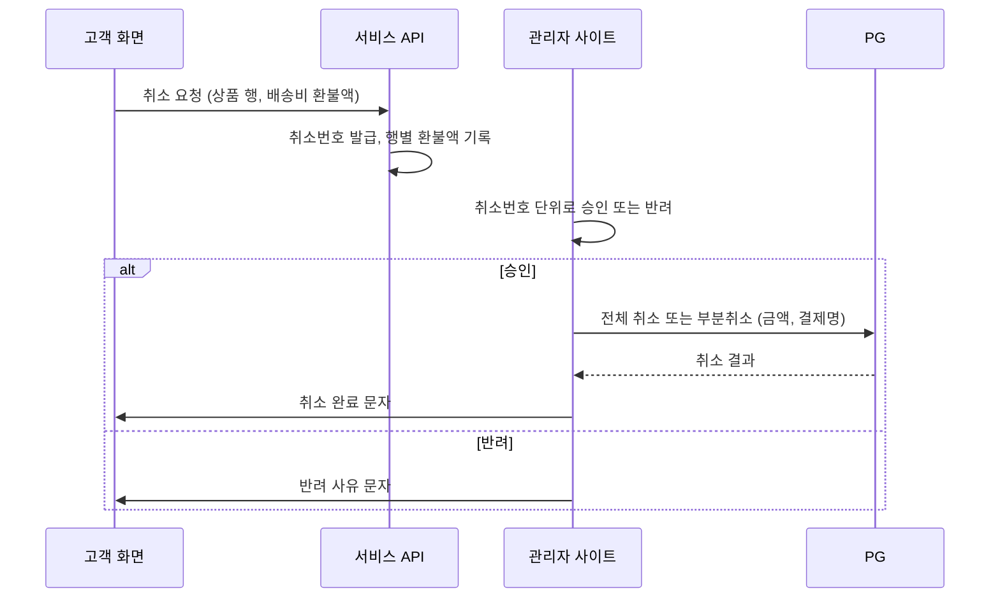

> 이 글은 2024년에 수행한 작업을 퇴사 후 정리한 기록입니다. 코드는 실제 소스가 아니라 원리를 설명하기 위해 새로 작성한 예시이며, 코드 안의 숫자도 예시입니다.

## 1. 들어가며

고객이 상품 세 개를 주문하고 그중 하나만 취소하고 싶다면 어떻게 해야 할까요?

기존 서비스에서는 일부 상품만 취소하고 싶어도 결제 전체를 취소해야 했습니다.

이 글은 2024년 4월, 커머스 서비스에 부분취소 기능을 도입한 기록입니다. 부분취소는 한 주문에서 일부 상품만 취소하고 해당 금액만 돌려주는 기능입니다.

고객의 취소 요청부터 운영자의 승인과 반려, 결제대행사(PG)를 통한 결제 취소, 결과 안내 문자까지 구현했습니다.

이 과정에서 가장 먼저 고민한 것은 취소 요청을 어떤 단위로 관리할 것인지였습니다. 이 글에서는 취소 요청의 처리 단위를 정하고, 환불 금액과 배송비를 계산하며, PG 부분취소로 연결한 과정을 소개합니다.

같은 서비스의 개인정보 마스킹 작업은 [보안검증 #2](/posts/personal-info-masking/)에서 다뤘습니다.

## 2. 주문은 상품별로 저장됐지만, 취소는 주문 전체로만 됐습니다

주문 데이터는 처음부터 상품마다 한 행씩 저장됐습니다. 예를 들어 고객이 A, B 두 상품을 결제하면 같은 주문번호로 두 행이 생성됩니다. 각 행에는 결제 시점의 판매가, 할인가, 수량도 함께 저장됩니다.

문제는 취소였습니다.

관리자 사이트의 취소 목록은 주문번호마다 대표 행 하나만 골라 보여 주었고, 운영자가 취소를 승인하면 해당 주문의 결제 전체를 취소했습니다.

부분취소를 도입하려면 세 가지를 먼저 정해야 했습니다.

- 고객의 취소 요청을 어떤 단위로 묶어 처리할 것인가?
- 취소할 상품의 환불 금액은 어떻게 계산할 것인가?
- PG에 전체 취소와 부분취소를 어떻게 구분해 요청할 것인가?

## 3. 취소 요청마다 취소번호를 붙여 처리 단위로 삼았습니다

부분취소가 가능해지면 한 주문에서 여러 번 취소 요청이 발생할 수 있습니다.

고객이 A, B, C 세 상품을 한 번에 구매했다고 가정하겠습니다. 월요일에는 A와 B를 함께 취소 요청하고, 수요일에는 C를 취소 요청할 수 있습니다.

운영자는 두 요청을 각각 승인하거나 반려해야 합니다. PG에도 월요일 요청에 포함된 A와 B의 금액, 수요일 요청에 포함된 C의 금액을 각각 취소 요청해야 합니다.

그렇다면 두 요청을 어떤 기준으로 구분해야 할까요?

세 가지 방법을 비교했습니다.

| 방법 | 발생 가능한 문제 |
|---|---|
| 주문번호로 묶기 | A, B, C가 모두 같은 주문번호를 사용하므로 월요일과 수요일의 취소 요청을 구분할 수 없음 |
| 상품 행마다 처리하기 | 월요일 요청이 A와 B로 나뉘어 승인, PG 취소, 안내 문자가 각각 두 번씩 발생할 수 있음. 한 상품만 성공하는 상태도 생길 수 있음 |
| 요청마다 취소번호 붙이기 | 월요일의 A, B는 취소번호 X, 수요일의 C는 취소번호 Y로 구분. 취소번호 하나당 승인, PG 취소, 안내 문자를 한 번씩 처리할 수 있음 |

저는 세 번째 방법을 선택했습니다.

고객이 취소를 요청할 때마다 새로운 취소번호를 발급하고, 해당 요청에 포함된 상품 행에 같은 취소번호를 저장했습니다. 관리자 사이트의 취소 목록도 주문번호가 아니라 취소번호 단위로 보여 주도록 변경했습니다.

주문번호는 '무엇을 함께 구매했는지'를 구분하고, 취소번호는 '고객이 한 번에 취소해 달라고 요청한 범위'를 구분합니다.

부분취소에서는 운영자의 승인과 PG 취소, 고객 안내 문자가 모두 고객의 취소 요청 한 건을 기준으로 움직여야 했습니다. 취소번호를 별도로 두면 이 처리 단위를 일관되게 유지할 수 있었습니다.

### 상품별 결과는 나누지 않고, 요청 단위로 통째 승인·반려했습니다

여러 판매자의 상품이 한 주문에 섞이는 쇼핑몰이라면 한 취소 요청 안에서도 상품마다 처리 결과가 달라질 수 있습니다.

예를 들어 A는 판매자 1이 취소를 승인하고, B는 이미 출고돼 판매자 2가 반품으로 처리하는 식입니다. 이런 구조라면 취소 요청으로 상품들을 묶더라도 요청 안에서 상품별 처리 결과를 별도로 관리해야 합니다.

반면 제가 담당한 서비스는 한 주문의 상품이 모두 같은 브랜드에서 함께 배송됐습니다. 운영 중에도 한 취소 요청에 포함된 상품 중 일부만 승인하고 싶다는 요구는 없었습니다.

그래서 취소번호 하나에 포함된 상품은 통째로 승인하거나 반려하도록 설계했습니다.

다른 서비스였다면 설계는 달라졌을 것입니다. 취소 처리 단위에 정답이 있는 것은 아닙니다. 주문과 배송이 실제로 어떻게 이루어지는지 이해한 만큼 적절한 설계도 달라진다고 생각합니다.

## 4. 환불액은 결제 시점의 가격으로 상품 행마다 계산했습니다

환불액은 취소를 요청하는 시점에 상품 행마다 계산해 기록했습니다.

기준은 고객이 결제 당시 해당 상품에 실제로 지불한 금액입니다. 할인 상품이라면 할인가에 수량을 곱하고, 할인이 적용되지 않았다면 판매가에 수량을 곱했습니다.

결제 시점의 판매가와 할인가가 주문 데이터에 이미 저장돼 있었기 때문에 현재 상품 정보를 다시 조회할 필요가 없었습니다. 상품 가격이 바뀌거나 할인이 종료되더라도 고객이 결제한 금액을 기준으로 환불할 수 있었습니다.

```java
// 취소 요청 처리 (예시)
public void requestCancel(String orderNo, List<Long> itemIds) {
    String cancelNo = CancelNo.generate();   // 요청마다 새 취소번호
    List<OrderItem> items =
        orderItemRepository.findByOrderNoAndIdIn(orderNo, itemIds);

    for(OrderItem item : items) {
        // 현재 상품 가격이 아니라 결제 시점에 저장한 가격을 사용
        int unitPrice = item.isDiscounted()
                ? item.getDiscountPrice()
                : item.getSalePrice();

        item.requestCancel(
            cancelNo,
            unitPrice * item.getQuantity()
        );

        statusHistory.record(item, CancelStatus.REQUESTED);
    }

    // 배송비 환불 처리 (생략)
}
```

### 배송비 환불액은 취소 요청에 한 번만 기록했습니다

배송비는 기존 무료 배송 기준을 따랐습니다.

취소 후 남은 상품 금액이 무료 배송 기준 이상이면 무료 배송을 유지합니다. 반대로 기준 아래로 내려가면 고객에게 돌려줄 환불 금액에서 배송비를 차감합니다.

이 계산에는 고객 화면에 이미 구현돼 있던 배송비 계산 로직을 재사용했습니다. 서버는 화면에서 전달한 배송비 환불액을 받아 취소 요청에 반영했습니다.

배송비 환불액은 상품 행마다 중복으로 더해지지 않도록 취소 요청에 포함된 한 행에만 기록했습니다.

따라서 같은 취소번호를 가진 상품 행들의 환불액을 모두 더하면 상품 환불액과 배송비를 합친 요청 한 건의 최종 환불 금액을 구할 수 있었습니다.

이 규칙을 고려하지 않은 화면에서 실제 문제가 발생하기도 했습니다.

2024년 12월, 관리자 화면에 표시되는 환불 예정 금액이 실제 환불액과 다르다는 문의가 들어왔습니다.

실제 환불 금액은 정상적으로 계산되고 있었습니다. 문제는 화면에서 배송비가 이미 포함된 환불액에 배송비를 한 번 더 더해 표시하고 있었다는 점이었습니다.

화면이 환불 금액을 별도로 계산하지 않고 서버에서 전달한 금액을 그대로 보여 주도록 수정했습니다.

## 5. 승인할 때 전체 취소와 부분취소를 구분했습니다

운영자가 취소 요청을 승인하면 서버는 PG에 전체 취소와 부분취소 중 어떤 방식으로 요청할지 결정해야 합니다.

예를 들어 A, B, C 세 상품을 구매한 고객이 A와 B만 취소 요청했다면 PG에는 A와 B의 금액만 취소해 달라고 요청해야 합니다.

반대로 A, B, C 모두 취소 요청했다면 결제 전체를 취소하면 됩니다.

저는 취소번호에 포함된 상품 행 수와 주문 전체 상품 행 수를 비교해 두 경우를 구분했습니다.

- 취소 요청에 포함된 상품 행 수와 주문 전체 상품 행 수가 같으면 전체 취소
- 두 행 수가 다르면 부분취소

```java
// 운영자 취소 승인 (예시)
public void approveCancel(String cancelNo) {
    List<OrderItem> cancelItems =
        orderItemRepository.findByCancelNo(cancelNo);

    List<OrderItem> orderItems =
        orderItemRepository.findByOrderNo(
            cancelItems.get(0).getOrderNo()
        );

    PgCancelRequest pgRequest =
        PgCancelRequest.of(cancelItems.get(0).getPayNo());

    if(cancelItems.size() != orderItems.size()) {
        int cancelAmount = cancelItems.stream()
                .mapToInt(OrderItem::getRefundAmount)
                .sum();

        pgRequest.partial(
            cancelAmount,
            payName(cancelItems)
        );   // 예: "A 포함 외 1건"
    }

    pgClient.cancel(pgRequest);   // 결과 코드 확인 (생략)

    for(OrderItem item : cancelItems) {
        item.approveCancel();
        statusHistory.record(item, CancelStatus.APPROVED);
    }
}
```

전체 취소는 결제번호를 전달하면 PG가 결제 금액 전체를 취소합니다.

부분취소는 부분취소 여부와 취소 금액, 결제명을 함께 전달해야 합니다. 취소 금액은 같은 취소번호를 가진 상품 행들의 환불액을 합산해 계산했습니다.

PG 호출을 중계하는 API에서도 부분취소 요청을 한 번 더 검사했습니다.

취소 금액이 0이거나, 결제명이 비어 있거나, 결제명이 100자를 초과하거나, 허용되지 않는 특수문자가 포함된 경우에는 PG로 요청을 보내지 않고 거부하도록 했습니다.

### 취소 요청부터 PG 취소까지의 흐름

전체 처리 과정을 정리하면 다음과 같습니다.



한 주문의 상품이 여러 번에 나눠 모두 취소되면 최종적으로 주문은 전체 취소 상태가 됩니다.

취소 이력은 별도 테이블에 주문번호와 상품 행을 함께 기록했습니다. 덕분에 어떤 상품이 언제, 어떤 취소 요청에 포함돼 처리됐는지 추적할 수 있었습니다.

## 6. 정리

이번 작업으로 주문 전체로만 처리하던 취소를 상품 단위의 부분취소까지 지원하도록 개선했습니다. 고객의 취소 요청마다 취소번호를 발급해 요청 건별로 승인·반려하고, 상품별 환불액과 배송비를 계산해 PG 부분취소로 연결했습니다.

가장 중요했던 것은 기능 구현보다 처리 단위를 정의하는 일이었습니다. 데이터는 상품 단위였지만, 승인과 PG 취소는 취소 요청 한 건을 기준으로 처리하는 것이 적절했습니다. 처리 단위는 데이터가 저장된 형태가 아니라 고객이 요청하는 범위와 서비스의 운영 방식에 맞춰 설계해야 한다고 생각합니다.

또한 환불 금액처럼 여러 화면에서 쓰는 값은 계산 책임을 명확히 해야 합니다. 서버가 계산한 값을 화면이 그대로 쓰도록 한 것만으로 중복 계산 문제를 막을 수 있었습니다.
