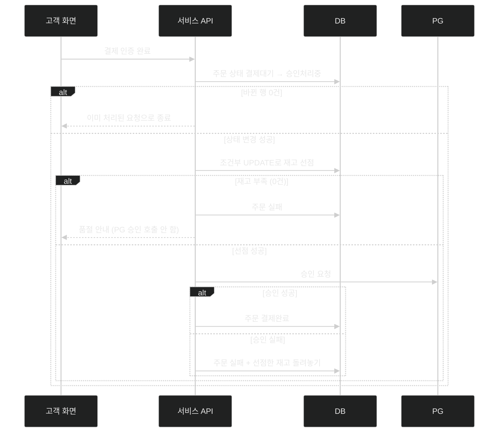

> 2024년 작업을 퇴사 후 정리한 글입니다. 코드는 실제 소스가 아닌 설명용 예시입니다.

## 1. 들어가며

이 글은 2024년 11월, 커머스 서비스에서 한정 수량 굿즈가 준비된 수량보다 1개 더 팔린 문제를 분석하고 재고 차감 방식을 바꾼 기록입니다. 저는 초과 판매 원인을 분석해 팀에 공유하고, 재고 차감 구조를 개선하는 역할을 맡았습니다.

## 2. 재고 수량이 음수가 된 문제 확인하기

### 입점사 문의로 재고 수량이 -1이 된 것을 알았습니다

금요일 오후, 입점사에서 상품 재고 수량이 음수로 표시된다는 문의가 들어왔습니다. 확인해 보니 재고가 1개 남은 한정판 굿즈를 두 고객이 1초 차이로 결제했고, 두 건 모두 결제가 완료되며 재고가 -1로 바뀌어 있었습니다.

다행히 입점사가 재고를 여유 있게 잡아 둔 덕분에 초과 판매된 1건도 발송할 수 있었습니다. 여유 물량마저 없었다면 결제를 완료한 고객의 주문을 일방적으로 취소해야 했습니다.

## 3. 두 결제가 모두 통과한 원인 찾기

### 로그를 초 단위로 맞추고 재현을 시도했습니다

먼저 두 결제의 요청과 응답 로그를 시간순으로 다시 정리했고, 두 요청이 1초 안에 들어와 둘 다 결제 승인까지 진행된 것을 확인했습니다.

두 기기로 같은 상품을 결제하는 재현도 시도했습니다. 처음에는 두 기기에서 결제 버튼을 동시에 눌렀지만, 두 번째 결제는 품절로 정상 처리됐습니다. 동시에 누르는 것만으로는 틈이 어디에 있는지 알 수 없어서, 먼저 코드 구조에서 원인을 좁혔습니다.

### 재고 확인과 차감 사이에 PG 승인 시간만큼 틈이 있었습니다

기존 결제 승인 흐름을 단순화하면 다음과 같습니다.

```java
// 기존 결제 승인 흐름 (예시)
public PayResult approve(String orderNo) {
    Order order = orderRepository.findByOrderNo(orderNo);

    PgResult pg = pgClient.approve(order);    // 외부 호출, 수 초가 걸림
    if(!pg.isSuccess()) {
        return PayResult.fail(pg);
    }

    order.markPaid();
    Goods goods = goodsRepository.findById(order.getGoodsId());
    goods.setSoldCount(goods.getSoldCount() + order.getQuantity());   // 승인 후 판매 수량 증가
    if(goods.getSoldCount() >= goods.getTotalCount()) {
        goods.setStatus(GoodsStatus.SOLD_OUT);
    }
    goodsRepository.save(goods);

    return PayResult.success();
}
```

품절 여부는 장바구니에 담을 때만 확인했고, 상품 상태는 결제가 승인된 뒤에야 품절로 바뀌었습니다. 그래서 마지막 1개를 두 고객이 동시에 결제하면, 두 결제 모두 판매 중 상태를 보고 결제대행사(PG) 승인까지 진행됐습니다.

초과 판매 사고 뒤 승인 직전에 재고를 한 번 더 조회하는 단계가 추가됐지만, 이것만으로는 막을 수 없었습니다. 재고를 조회하는 시점과 실제로 차감하는 시점 사이에 PG 승인이 끼어 있었기 때문입니다. 정리하면 원인은 두 가지였습니다.

- 재고 확인과 차감 사이에 PG 승인이 있어서, 다른 요청이 끼어들 수 있는 시간이 수 초나 됐습니다.
- 차감 UPDATE에 "잔여 재고가 있을 때"라는 조건이 없어, 앞의 확인을 통과한 요청은 재고가 0이어도 차감에 성공했습니다.

원인을 분석한 뒤 증상을 다시 재현했습니다. 두 기기 모두 승인 직전 단계까지 띄워 둔 상태에서 동시에 승인을 요청하자, 두 결제가 모두 승인되고 재고가 -1이 됐습니다.

## 4. 확인과 차감을 하나의 UPDATE로 합치기

### 재고를 지키는 방법을 비교한 뒤 조건부 UPDATE를 골랐습니다

동시 요청에서 재고를 지키는 방법을 다음과 같이 비교했습니다.

| 방법                  | 결과                                                                                            |
|-----------------------|-------------------------------------------------------------------------------------------------|
| synchronized          | 서버가 여러 대면 서버마다 따로 잠겨 효과가 없음                                                 |
| SELECT ... FOR UPDATE | 동작은 하지만 조회와 수정을 두 번의 쿼리로 나눠야 했고, UPDATE 하나로 끝나는 방법이 더 단순했음 |
| @Version 낙관적 락    | 충돌하면 재시도 로직이 필요하고, 관리자 사이트도 같은 테이블을 다른 방식으로 갱신하고 있었음    |
| Redis 재고 카운터     | 한정 굿즈 수백 건 규모에 저장소를 하나 더 운영할 이유가 없었음                                  |
| 조건부 UPDATE         | 추가 저장소나 별도 잠금 쿼리 없이 UPDATE 한 번으로 확인과 차감을 끝낼 수 있음                   |

다른 방법들은 추가 인프라나 별도의 잠금·재시도 로직이 필요했지만, 조건부 UPDATE는 기존 DB만으로 가장 단순하게 문제를 풀 수 있었습니다. **재고가 충분한지 확인하는 일과 줄이는 일을 하나의 UPDATE로 합쳐, 판단을 애플리케이션이 아니라 DB가 하도록 바꿨습니다.**

```java
// 재고가 충분할 때만 차감 및 품절 상태 전환 (예시)
@Modifying
@Query(value = "UPDATE goods SET sold_count = sold_count + :qty, " +
               "       status = CASE WHEN sold_count + :qty >= total_count THEN 'SOLD_OUT' ELSE status END " +
               " WHERE goods_id = :goodsId AND status = 'ON_SALE' " +
               "   AND total_count - sold_count >= :qty", nativeQuery = true)
int reserve(@Param("goodsId") Long goodsId, @Param("qty") int qty);
```

바뀐 행이 0개면 재고 부족으로 처리했고, 마지막 재고를 선점해 품절(`SOLD_OUT`)이 된 경우라도 추후 재고가 원복되면 다시 판매 중(`ON_SALE`)으로 되돌리도록 처리했습니다. PostgreSQL의 기본 격리 수준(READ COMMITTED)에서는 같은 행을 갱신하려는 두 번째 요청이 첫 번째 요청이 끝날 때까지 기다린 뒤, 줄어든 재고로 WHERE 조건을 다시 확인합니다. 그래서 남은 수량보다 많은 요청이 성공할 수 없었습니다.

### 승인 전에 선점하고, 승인이 실패하면 돌려놓았습니다

PG 승인을 기다리는 동안 다른 요청이 같은 재고를 가져가지 못하도록, 결제 전에 재고를 먼저 확보(선점)해야 했습니다. 그래서 차감 시점을 PG 승인 뒤에서 승인 전으로 옮겼습니다.

대신 승인이 실패하면 잡아 둔 재고를 돌려놓아야 했습니다. PG 응답을 기다리는 수 초 동안 DB를 붙잡고 있지 않도록, PG 호출은 트랜잭션 밖에 두고, 선점과 결과 반영을 각각 짧은 트랜잭션으로 나눴습니다.



### 같은 승인 요청이 두 번 와도 한 번만 처리했습니다

선점을 승인 요청마다 하면, 결제 결과가 새로고침이나 재전송으로 두 번 들어왔을 때 재고도 두 번 잡힙니다. 조건부 UPDATE만으로는 이런 중복을 막을 수 없어서, 같은 요청은 한 번만 처리되도록(멱등성) 따로 막아야 했습니다.

그래서 선점 전에 주문 상태를 결제대기에서 승인처리중으로 바꾸는 UPDATE를 먼저 실행하고, 바뀐 행이 없으면 이미 처리된 요청으로 보고 그대로 돌려보냈습니다. 재고를 돌려놓을 때도 `sold_count >= :qty` 조건을 걸어, 판매 수량이 음수로 내려가지 않게 했습니다.

### 오래 머문 승인처리중 주문은 스케줄러로 정리했습니다

PG 응답을 받지 못해 승인처리중에 남는 주문도 생길 수 있었습니다. 그래서 승인처리중으로 바뀐 지 5분이 지난 주문을 스케줄러가 주기적으로 찾아 PG에 승인 여부를 조회했습니다. 승인된 주문은 결제완료로 바꾸고, 승인되지 않은 주문은 실패로 바꾼 뒤 선점한 재고를 돌려놓았습니다.

재고가 두 번 돌아오지 않도록, 원복 전에 주문 상태를 승인처리중에서 실패로 바꾸는 UPDATE를 먼저 실행하고 바뀐 행이 1개일 때만 재고를 돌려놓았습니다. 승인 실패 처리와 스케줄러가 같은 주문을 동시에 정리하더라도 상태를 바꾼 한쪽만 원복합니다. 재고가 부족해 선점하지 못한 주문은 그 자리에서 실패로 바꿔, 스케줄러가 잡은 적 없는 재고를 돌려놓는 일이 없게 했습니다.

## 5. 동시 요청 100건으로 다시 검증하기

당시에는 두 기기 재현만 하고, 많은 요청을 동시에 보내는 테스트는 하지 않았습니다. 그래서 퇴사 후 같은 구조를 작은 예제로 만들어 다시 확인했습니다.

조건: 재고 10개, 동시 요청 100건 (`ExecutorService` + `CountDownLatch`, PostgreSQL 16.15). PG 승인은 200~500ms 지연으로 흉내 냈고, 방식마다 5번씩 실행했습니다.

| 방식                      | 초과 판매 |
|---------------------------|-----------|
| 기존 (확인 후 승인)       | 64~90건   |
| 변경 (조건부 UPDATE 선점) | 0건       |

재고는 10개이므로 10건을 넘겨 성공한 결제는 모두 초과 판매입니다. 기존 방식은 매번 64~90건이 재고 없이 결제됐고, 변경 방식은 몇 번을 실행해도 정확히 10건만 성공해 초과 판매가 한 건도 없었습니다.

## 6. 한계와 지금 다시 한다면

변경을 반영한 뒤 운영에서 초과 판매는 다시 생기지 않았습니다. 다만 당시 변경은 동시성 테스트 없이 반영했습니다. 조건부 UPDATE는 원리상 초과 판매를 막지만, 지금이라면 반영 전에 5장과 같은 테스트로 수치를 먼저 확인하겠습니다.

5장 테스트에서 PG 승인이 30% 확률로 실패하게 하자, 변경 방식은 재고 10개 중 6~10개만 팔렸습니다. 승인에 실패한 요청이 재고를 돌려놓기 전에 다른 요청이 품절로 거절됐기 때문입니다. 초과 판매를 막는 대신 덜 팔릴 수 있다는 뜻이라, 지금이라면 품절 안내 후 재고가 돌아오면 다시 구매할 수 있는 흐름도 함께 고민하겠습니다.

## 7. 정리

동시 결제로 재고가 -1이 된 문제를 로그와 코드 구조로 분석하고, 재고 확인과 차감을 조건부 UPDATE 하나로 합쳤습니다. 차감 시점을 PG 승인 전으로 옮기고 승인이 실패하면 재고를 돌려놓았으며, 주문이 결제대기 상태일 때만 승인을 진행하게 해서 같은 승인 요청이 반복돼도 한 번만 처리했습니다. 승인처리중으로 오래 남은 주문은 스케줄러가 PG에 승인 여부를 조회해 정리했습니다.

처음 재현에 실패했을 때 원인을 좁힌 것은 코드 구조였습니다. 확인과 차감 사이에 PG 승인이 끼어 있다는 점을 코드에서 찾은 뒤에야, 그 틈을 노려 재현할 수 있었습니다.

승인 직전 확인을 하나 더 두는 것만으로는 동시 요청을 막지 못했던 것처럼, 확인 단계를 늘리는 것만으로는 부족했습니다. 확인과 차감을 하나의 UPDATE로 합쳐 **판단과 변경의 원자성(Atomicity)을 DB에 위임한 뒤에야** 초과 판매를 막을 수 있었습니다.
