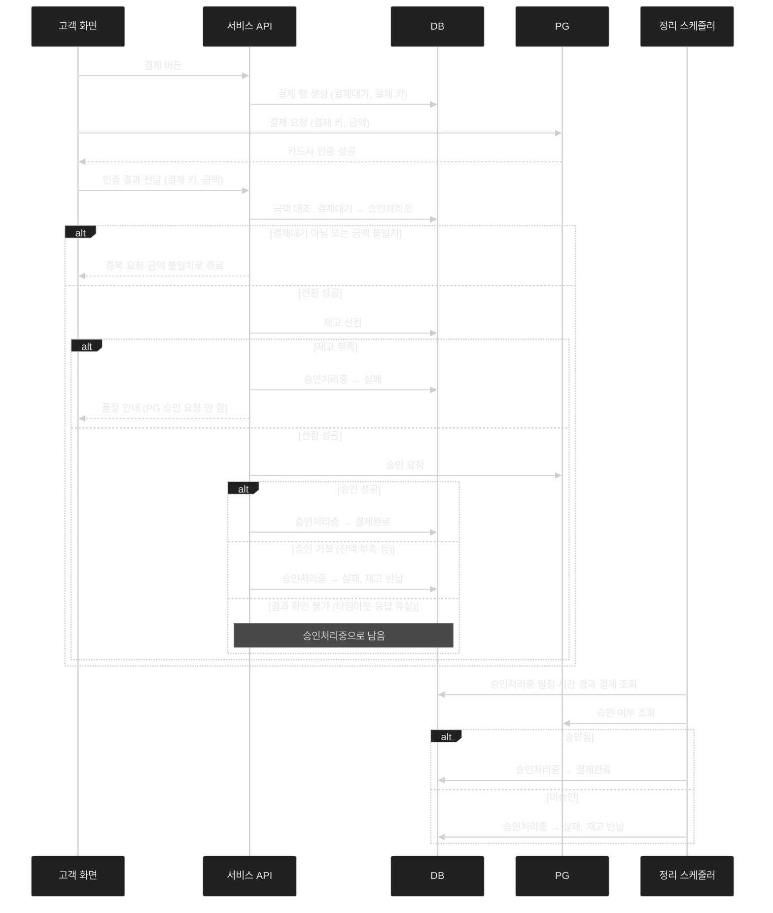

> 2024년 작업을 퇴사 후 정리한 글입니다. 코드는 실제 소스가 아닌 설명용 예시입니다.

## 1. 들어가며

이 글은 2024년 11월, 커머스 서비스에서 한정 수량 굿즈가 준비된 수량보다 1개 더 팔린 문제를 고친 기록입니다. 초과 판매 자체는 재고 차감 쿼리 하나로 막을 수 있었습니다. 더 오래 고민한 부분은 그다음이었습니다. 재고를 PG 승인보다 먼저 잡도록 바꾸자, DB에는 반영됐지만 PG 결과는 아직 모르는 구간이 생겼고, 그 구간에서 승인 거절·중복 요청·결과 확인 불가를 어떻게 정리할지가 실제 설계 문제가 됐습니다.

## 2. 재고가 -1이 된 원인

금요일 오후, 입점사에서 상품 재고가 음수로 표시된다는 문의가 들어왔습니다. 재고가 1개 남은 한정판 굿즈를 두 고객이 1초 차이로 결제했고, 두 건 모두 결제가 완료되며 재고가 -1이 되어 있었습니다. 입점사가 재고를 여유 있게 잡아 둔 덕분에 초과 판매된 1건도 발송할 수 있었습니다.

기존 흐름은 품절 여부를 장바구니에 담을 때 확인하고, PG 승인이 끝난 뒤에 판매 수량을 늘리는 구조였습니다. 사고 직후 승인 직전에 재고를 한 번 더 조회하는 단계가 추가됐지만, 조회와 차감 사이에 수 초가 걸리는 PG 승인이 그대로 남아 있어 동시 요청을 막지 못했습니다. 차감 UPDATE에도 잔여 재고 조건이 없어서 재고가 0이어도 그대로 차감됐습니다.

처음에는 두 기기로 버튼을 동시에 눌러 재현하려 했지만 정상적으로 품절 처리됐습니다. 코드에서 PG 승인 구간이 틈이라는 것을 찾은 뒤, 두 기기를 승인 직전 단계까지 진행해 두고 동시에 승인을 요청하자 두 결제가 모두 성공하며 같은 증상이 재현됐습니다.

## 3. 확인과 차감을 하나의 UPDATE로

재고 확인과 차감을 조건이 붙은 UPDATE 하나로 합쳐, 판단을 애플리케이션이 아니라 DB가 하도록 바꿨습니다. 검토한 방법은 다음과 같습니다.

- `synchronized`: 다중 서버에서는 서버마다 따로 잠겨 효과 없음
- `SELECT ... FOR UPDATE`: 동작하지만 조회와 수정을 두 쿼리로 나눠야 함
- 낙관적 락(`@Version`): 요청이 한 행에 몰리는 한정 상품은 충돌이 잦아 재시도가 반복됨
- Redis 카운터(`DECRBY`): 수백 건 규모의 한정 굿즈에 저장소를 하나 더 운영해야 함
- **[선택] Atomic Update(원자적 업데이트)**: WHERE에 잔여 재고 조건을 넣어, 추가 저장소나 별도 잠금 쿼리 없이 UPDATE 한 번으로 확인과 차감을 처리

```sql
-- 조건부 UPDATE로 재고 확인과 차감을 원자적으로 처리 (반영 행 0이면 재고 부족)
UPDATE goods
   SET sold_count = sold_count + :qty,
       status = CASE WHEN sold_count + :qty >= total_count THEN 'SOLD_OUT' ELSE status END -- 마지막 재고 차감 시 품절 전환
 WHERE goods_id = :goodsId AND status = 'ON_SALE'
   AND total_count - sold_count >= :qty -- 잔여 재고가 충분할 때만 반영
```

두 결제 요청이 같은 상품에 UPDATE를 동시에 실행하면, PostgreSQL의 기본 격리 수준(READ COMMITTED)에서는 늦게 도착한 요청이 먼저 행을 잠근 요청의 커밋을 기다립니다. 대기가 끝나면 늦은 요청은 처음 읽은 값이 아니라 커밋된 최신 행으로 WHERE 조건을 다시 평가하므로, 재고가 이미 소진됐다면 바뀐 행이 0개가 되어 재고 부족으로 처리됩니다.

판정을 DB에 맡겨도, 차감이 PG 승인 뒤에 있으면 여러 요청이 동시에 PG 승인을 통과한 뒤에야 재고 부족이 판정되어 이미 승인된 결제를 취소해야 하는 문제가 남습니다. 그래서 차감 시점을 PG 승인 앞으로 옮겨, 재고를 먼저 잡은(선점) 요청만 승인 단계로 넘어가게 했습니다.

## 4. 선점이 남긴 결제 미확정 구간

선점으로 초과 판매는 막았지만, 재고가 줄어드는 시점과 결제가 확정되는 시점이 갈라졌습니다. 이제 문제는 재고가 모자라는 것이 아니라, 승인이 끝나지 않은 결제 건이 재고를 붙잡고 있다는 것입니다. PG 응답을 기다리는 수 초 동안 DB 커넥션과 잠금을 붙잡지 않도록 PG 승인 호출은 트랜잭션 밖에 두고 선점과 결과 반영을 각각 짧은 트랜잭션으로 나눴기 때문에, DB와 PG의 결과도 하나로 묶이지 않았습니다. 결제 미확정 구간에서는 세 가지 문제가 생길 수 있었습니다.

1. PG 승인 거절 시 선점한 재고 반납 필요(보상)
2. 같은 인증 결과 중복 유입 시 재고 이중 선점(멱등성)
3. PG 승인 결과 확인 불가 시 해당 결제 건이 선점한 재고의 장기 점유

## 5. 결제 상태 흐름과 재고 처리 시점

고객이 결제 버튼을 누르면 결제창이 뜨기 전에 결제 행이 만들어지고, 서비스가 발급한 결제 키가 그 행의 기본 키로 저장됩니다. 결제 키는 결제 요청에 실려 PG로 가고, 카드사 인증이 끝나면 고객이 인증 결과와 같은 키를 들고 서비스로 돌아옵니다. 서버는 돌아온 키로 결제 행을 찾아 금액을 대조한 뒤 승인을 진행합니다.

결제 행은 결제가 어디까지 진행됐는지를 상태(결제대기·승인처리중·결제완료·실패)로 기록합니다. 결제 하나가 생성부터 마무리까지 거치는 흐름은 다음과 같습니다.



- **중복 요청**: 새로고침이나 재전송으로 같은 인증 결과가 다시 들어오면, 결제 상태를 확인해 중복을 막습니다. 두 번째 요청은 이미 승인 처리가 시작된 결제를 만나 그대로 종료됩니다.
- **재고 선점**: 승인 처리를 시작한 요청만 재고를 차감하며, 상태 전환(결제대기에서 승인처리중)과 재고 선점은 하나의 짧은 트랜잭션으로 묶었습니다. 재고가 부족하면 결제 상태를 실패로 변경하고, PG에 승인을 요청하지 않습니다.
- **승인 거절**: 잔액 부족처럼 PG가 승인 거절을 응답한 경우에만 실패 전환(승인처리중에서 실패)과 재고 반납을 하나의 보상 트랜잭션으로 묶어 처리합니다. API 응답과 정리 스케줄러가 동시에 실패 처리를 시도하더라도 승인처리중에서 실패로 바꾼 1건만 재고를 반납하도록 제한해 이중 복원을 막았습니다. 반납할 때는 판매 수량이 음수가 되지 않도록 처리하고, 품절이었던 상품은 다시 판매 가능한 상태로 되돌렸습니다.
- **결과 확인 불가**: 타임아웃이나 응답 유실처럼 승인 결과를 알 수 없는 결제는 실패로 처리하지 않고 승인 처리 중인 상태로 남깁니다. 스케줄러가 일정 시간 넘게 남아 있는 결제를 찾아 PG에 승인 여부를 조회하고, 승인됐으면 결제 완료로, 아니면 실패로 변경한 뒤 재고를 반납합니다.

```java
// 승인 처리 흐름 (예시)
public PayResult approve(String paymentId, long amount) {
    // 1. 선점 트랜잭션: 금액 대조·상태 전환과 재고 선점을 한 트랜잭션으로 처리
    if (paymentRepository.transitionIfAmountMatches(paymentId, amount, PENDING, APPROVING) == 0) {
        return PayResult.alreadyHandledOrMismatch(); // 중복 요청 또는 금액 불일치 차단
    }
    Payment payment = paymentRepository.findById(paymentId);
    if (goodsRepository.reserve(payment.getGoodsId(), payment.getQuantity()) == 0) {
        paymentRepository.transition(paymentId, APPROVING, FAILED);
        return PayResult.soldOut();                  // 재고 부족: PG 승인 요청 없이 종료
    }

    // 2. 외부 PG 승인 호출 (지연 동안 DB 커넥션·잠금을 잡지 않도록 트랜잭션 밖)
    PgResult pg = pgClient.approve(payment);

    // 3. 승인 결과 반영
    if (pg.isApproved()) {
        paymentRepository.transition(paymentId, APPROVING, PAID);
        return PayResult.success();
    }
    if (pg.isDeclined()) {
        // 보상 트랜잭션: 실패 전환에 성공한 1건만 재고 반납 (스케줄러와 경합 시 이중 복원 방지)
        if (paymentRepository.transition(paymentId, APPROVING, FAILED) == 1) {
            goodsRepository.release(payment.getGoodsId(), payment.getQuantity());
        }
        return PayResult.fail(pg);
    }

    // 4. 타임아웃·응답 유실 등 결과 확인 불가: APPROVING 유지 후 정리 스케줄러가 PG 조회로 확정
    return PayResult.pending();
}
```

## 6. 정리

초과 판매는 재고 확인과 차감을 원자적 업데이트 하나로 합쳐 막았습니다. 반영 후 운영에서 초과 판매는 다시 생기지 않았고, 퇴사 후 같은 구조로 재현한 실험(재고 10개, 동시 요청 100건)에서도 기존 방식은 64~90건이 초과 판매된 반면 변경 방식은 0건이었습니다.

그 대가로 재고 선점이 PG 승인 앞으로 오면서, DB와 PG 결과가 어긋나는 구간을 다뤄야 했습니다. 같은 요청의 중복은 결제 상태로 거르고, PG가 거절한 결제만 재고를 반납하며, 결과를 알 수 없는 결제는 스케줄러가 PG에 조회해 정리했습니다. 또한 PG 승인 실패가 섞이면 선점된 재고가 반납되기 전까지 뒤따른 정상 요청이 품절로 거절되어 덜 팔릴 수 있었고, 퇴사 후 재현 실험에서도 승인 30% 실패 조건을 넣자 재고 10개 중 6~10개만 판매되는 트레이드오프가 확인됐습니다.
