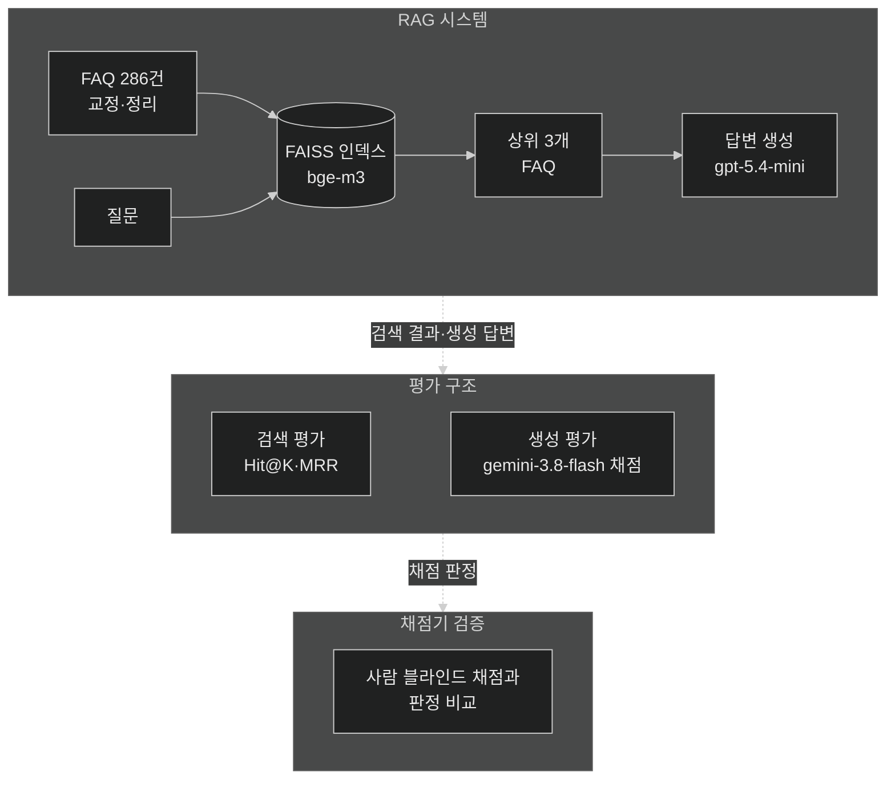

> 2026년 6~11월 개인 프로젝트를 정리한 글입니다. 코드와 실험 결과는 [seo-yk/gosi-rag](https://github.com/seo-yk/gosi-rag)에서 확인할 수 있습니다.

## 1. 들어가며

RAG(검색 증강 생성)란 모델이 학습한 지식 대신, 지정한 문서에서 관련 내용을 먼저 검색해 그 문서만 근거로 답하는 방식을 말합니다. 저는 공공데이터 포털의 국가공무원 채용시험 FAQ 289건(교정 후 286건)을 활용하여 RAG 시스템을 만들었습니다. 그리고 답이 틀렸을 때 원인이 검색에 있는지 생성에 있는지 찾을 수 있도록 두 단계를 따로 평가하는 구조를 만들었고, 생성 답변을 채점하는 LLM 채점기도 사람 채점과 비교해 다시 검증했습니다.

제가 RAG 시스템을 만들면서 확인한 내용은 세 가지입니다.

- 이 데이터에서 답변 실패의 대부분은 생성이 아니라 검색 단계에서 나왔습니다(4장).
- 로컬 모델 EXAONE 3.5 7.8B는 같은 근거를 받고도 근거에 없는 내용을 섞어 합격률이 gpt-5.4-mini보다 낮았습니다(4장).
- 자동 채점기는 사람 블라인드 채점과 비교해 골랐고, 그 과정에서 제 채점의 유창성 편향을 발견했습니다(5장).

2026년 6~7월에 진행한 1차 실험에서 문제를 발견해 재실험했고, 본문에 작성된 수치는 모두 재실험 결과를 기반으로 합니다. 1차 실험과 관련된 내용은 다음 글에서 다루겠습니다.

프로젝트는 AI 도구(Claude)와 협업했습니다. 코드 작성 및 실행, 평가 문항 초안 작성은 AI가 맡았고, 실험 방향과 판단 기준, 평가셋 확정, 사람 채점처럼 결과를 좌우하는 판단은 직접 했습니다.

## 2. 전체 아키텍처

RAG 시스템은 질문에 맞는 FAQ를 찾는 '검색'과, 검색한 근거로 답을 만드는 '생성' 두 단계로 동작합니다. 사용자 질문에 대한 답이 틀렸을 때 원인은 필요한 FAQ를 찾지 못한 검색 단계일 수도 있고, 검색한 내용을 잘못 해석한 생성 단계일 수도 있습니다. 하지만 최종 답변만 확인해서는 두 경우를 구분할 수 없었습니다. 따라서 단계마다 검색과 생성을 따로 평가할 수 있게 하면서, 생성 답변을 채점하는 LLM 채점기 자체도 그대로 믿는 대신 사람 채점과 비교해 재차 검증했습니다.

이 글에서 평가는 검색과 생성 단계의 성능을 지표로 재는 일을, 채점은 답변 하나하나에 점수와 합격 여부를 매기는 일을 가리킵니다. 검색 평가는 Hit@K·MRR로 하고, 생성 평가는 채점 결과로 계산한 합격률로 합니다.



평가에는 148문항과, FAQ에 답이 없는 범위 밖 질문 10문항을 사용했습니다. 평가셋 문항마다 정답 FAQ를 표시해 두었기 때문에, 검색 결과에 정답 FAQ가 들어 있는지와 생성한 답이 맞는지를 따로 셀 수 있습니다.

답변에 FAQ가 여러 개 필요한 질문은 정답을 두 종류로 나눠 표시했습니다. 하나라도 빠지면 답을 완성할 수 없는 필수 근거와, 내용이 같아 서로 대신 쓸 수 있는 대체 근거입니다. 예를 들어 두 가지를 함께 묻는 질문이라면 두 주제의 FAQ가 모두 검색되어야 성공으로 봅니다.

## 3. 검색 모델 고르기

### 모델 선택 기준: 5%p 이상의 성능 차이

평가셋으로 선정한 148문항에서 한 문항은 약 0.7%p에 해당합니다. 만약 두세 문항 차이로 모델의 우열을 가리면, 평가셋이 조금만 바뀌어도 결론이 뒤집힐 수 있습니다. 그래서 두 구성의 차이가 5%p 이내라면 성능 차이가 확인되지 않은 것으로 보기로 했습니다.

### 임베딩 모델: 무료 다국어 모델 bge-m3 선택

임베딩 모델은 글의 의미를 숫자 벡터로 바꿔, 질문과 FAQ가 얼마나 비슷한지 비교할 수 있게 해 주는 모델입니다. 모델 4개를 같은 평가셋으로 비교했고, 검색 성능은 두 가지 지표로 확인했습니다.

- **Hit@K:** 검색 결과 상위 K개 안에 정답 FAQ가 들어 있는 문항의 비율입니다. 필수 근거가 여러 개인 문항(복수근거)은 모든 필수 근거가 K개 안에 있어야 성공으로 셉니다.
- **MRR:** 정답 FAQ가 몇 번째에 나왔는지를 반영한 점수입니다. 1위면 1, 2위면 0.5, 3위면 0.33처럼 순위의 역수를 문항마다 구해 평균합니다. 1에 가까울수록 정답이 맨 위에 자주 나온다는 뜻입니다.

복수근거 37문항은 1위 결과 하나만으로 필수 근거를 모두 채울 수 없기 때문에 Hit@1이 항상 0이 됩니다. 이 문항까지 포함하면 전체 Hit@1은 최대 75%까지만 나올 수 있으므로, Hit@1과 MRR은 복수근거 질문을 제외한 111문항, Hit@5는 148문항을 기준으로 계산했습니다.

| 모델                            | Hit@1 (111문항) | Hit@5 (148문항) | MRR (111문항) |
|---------------------------------|----------------:|----------------:|--------------:|
| bge-m3                          |           97.3% |           98.7% |         0.985 |
| KURE-v1 (한국어 특화)           |           95.5% |           99.3% |         0.975 |
| text-embedding-3-large (OpenAI) |           92.8% |           98.7% |         0.959 |
| multilingual-e5-small           |           91.9% |           97.3% |         0.952 |

비교 결과 5%p를 넘은 차이는 bge-m3와 e5-small 사이(5.4%p) 하나뿐이었습니다. KURE-v1은 bge-m3를 한국어로 추가 학습한 모델이라, 두 모델을 비교하면 한국어 추가 학습의 효과만 따로 볼 수 있습니다. 그런데 이 차이도 5%p 안이었습니다. 한국어 특화 모델이나 유료 API가 더 낫다는 근거를 찾지 못했기 때문에, 무료로 쓸 수 있는 다국어 모델 bge-m3를 선택했습니다.

임베딩에는 제목과 본문을 함께 넣었습니다. 4개 모델 모두 제목만 넣었을 때보다 Hit@1이 0.9~5.4%p 높았습니다.

### 청킹: FAQ 하나를 청크 하나로

청킹은 문서를 검색 단위로 자르는 작업입니다. 두 가지 방식을 비교했습니다.

- **행 단위:** FAQ 파일의 한 행, 즉 제목(질문)과 본문(답변)으로 이루어진 FAQ 하나를 청크 하나로 씁니다. FAQ 286건이 청크 286개가 됩니다.
- **문장 단위:** 본문을 마침표·물음표·느낌표 뒤에서 잘라 문장마다 청크를 만들고, 20자보다 짧은 조각은 앞 문장에 붙였습니다. 문장만으로는 어떤 질문에 대한 답인지 알기 어려워, 청크마다 원래 FAQ의 제목을 함께 넣어 임베딩했습니다. 이렇게 만든 청크는 634개입니다. 검색 결과 상위권을 같은 FAQ의 문장들이 채우지 않도록, 지표를 계산하기 전에 FAQ 번호가 같은 결과는 하나만 남겼습니다.

저는 행 단위를 선택했습니다. 수치만 보면 문장 단위가 0.9%p 높았지만 5%p 기준 안이었고, FAQ 본문이 평균 255자로 짧아 문장 단위로 더 잘게 나눠도 차이가 확인되지 않았습니다. 행 단위는 검색 결과를 그대로 생성 단계의 근거로 넘길 수 있어 추가 처리가 필요 없다는 장점도 있었습니다.

## 4. 생성 실패 원인 나누기

### 정답 FAQ 조건으로 검색 실패와 생성 실패 구분

검색 탓과 생성 탓을 나누기 위해, 같은 148문항을 세 가지 조건으로 답하게 했습니다.

| 조건    | 생성 모델              | 근거          |          합격률 | 범위 밖 질문 차단 (사람 판정) |
|---------|------------------------|---------------|----------------:|------------------------------:|
| A       | gpt-5.4-mini           | 검색 결과 3개 | 93.2% (138/148) |                         10/10 |
| B       | gpt-5.4-mini           | 정답 FAQ      | 98.0% (145/148) |                     측정 안 함 |
| C       | EXAONE 3.5 7.8B (로컬) | 검색 결과 3개 | 69.6% (103/148) |                         10/10 |

A와 B는 생성 모델과 프롬프트가 같고, 근거로 주는 FAQ만 다릅니다.

- **A (실제 서비스 조건):** 검색이 찾은 상위 FAQ 3개를 보고 답합니다.
- **B (검색을 건너뛴 조건):** 평가셋에 표시해 둔 정답 FAQ를 바로 줍니다. 검색이 항상 성공했다고 가정한 셈입니다.

이렇게 조건을 나누면 A에서 틀리고 B에서 맞은 문항은 검색 문제, B에서도 틀린 문항은 생성 문제로 볼 수 있습니다. A와 C는 검색 결과가 같고 생성 모델만 다르기 때문에, 두 조건을 비교하면 생성 모델의 차이를 확인할 수 있습니다. 세 조건 모두 같은 프롬프트를 썼고, temperature는 0으로 고정했습니다.

### 실패 10건 중 8건의 원인은 검색 단계

A 조건에서 실패한 10건 중 8건은 검색이 필요한 FAQ를 찾지 못한 경우였습니다. 8건 모두 FAQ가 2개 이상 필요한 복수근거 질문이었고, 질문의 중심 주제로 검색이 몰리면서 두 번째 주제의 FAQ를 놓친 것이 원인이었습니다.

근거 없이 틀린 답은 생성이 아니라 검색의 실패이므로, 생성 모델의 실력은 필요한 FAQ를 모두 받은 140문항만 놓고 따로 계산했습니다(전체 148문항 기준 합격률은 93.2%). 140문항 기준 A의 합격률은 98.6%로, 정답 FAQ를 직접 받은 B(98.0%)와 비슷했습니다. 검색이 필요한 FAQ를 가져오기만 하면 생성 모델은 정답을 직접 받은 경우만큼 답했다는 뜻이고, 따라서 이 데이터에서는 검색이 병목이라고 판단했습니다.

나머지 2건은 필요한 FAQ를 받고도 틀린 경우입니다. 그중 답안지 과목 순서를 묻는 질문에서 원문은 '순서를 바꾸어 표기하여도, 문제책 순서대로 채점이 되므로 착오 없으시기 바랍니다'였습니다. 순서를 바꾸면 오답이 될 수 있으니 주의하라는 뜻인데, 모델은 이를 '바꿔도 된다'로 해석했습니다.

### 로컬 모델의 근거 밖 답변

C는 A와 같은 검색 결과와 프롬프트를 받았는데도 합격률이 23.6%p 낮았습니다. 필요한 FAQ가 검색된 문항에서도 37건이 실패했고, 그중 36건에는 존재하지 않는 URL이나 FAQ에 없는 규정처럼 근거 밖 내용이 섞여 있었습니다. 제공된 FAQ만 근거로 답하라는 같은 지시를 받고도, 학습된 지식을 답변에 섞은 것입니다. 범위 밖 질문 10개에는 A와 C 모두 근거가 없다고 답했습니다.

## 5. 채점기 검증

### 사람 채점 40문항 기준의 채점기 선정

생성 답변은 LLM 채점기가 근거성·정확성·필수 근거 충족·답 회피 네 항목으로 채점하고, 네 항목을 모두 만족해야 합격입니다. 합격 여부는 채점기가 직접 정하지 않고, 채점기가 준 점수로 파이썬 코드가 계산합니다.

다만 LLM 채점 결과를 그대로 믿지는 않았습니다. 먼저 A와 B의 답변 40문항을 모델 이름과 조건을 가린 채 제가 직접 채점했고, 채점기 후보 6개가 제 판정과 얼마나 일치하는지 비교했습니다. 후보는 로컬 모델 2개(gemma3 4B, qwen2.5 7B)와 Gemini 4개(2.5·3.5·3.7·3.8-flash)입니다. OpenAI 모델은 생성 모델과 같은 계열이라 자기 계열의 답변을 후하게 볼 수 있다고 판단해 후보에서 제외했습니다.

비교 결과 로컬 모델 2개는 맞는 답에도 0점을 주는 경우가 많아 일치율이 30~40%에 그쳤고, gemini-3.8-flash는 사람 판정과 90.0% 일치해 채점기로 선택했습니다(3.5·3.7-flash와 판정이 같아 최신 모델 선택).

### 채점기 비교 중 드러난 사람 채점의 오류

채점기를 검증하는 과정에서 제 채점도 고쳐야 했습니다. EXAONE 답변 15문항을 처음 채점할 때, 저는 14문항을 통과시키며 "질문한 내용만 답하고 가독성이 좋다"고 메모했습니다. 그런데 채점기와 판정이 갈린 7건을 채점기가 지적한 내용(근거에 없는 URL, 근거에 없는 "공고일" 기준)을 기준으로 원문 FAQ와 다시 대조해 보니, 6건이 불합격이었습니다. 매끄럽게 쓰인 답변이 근거 밖 오류를 가리고 있었던 것입니다. 이후로는 가독성이 떨어지더라도 정확한 정보를 우선한다는 채점 원칙을 정했습니다.

채점기와 사람 판정의 일치도는 불일치 문항을 재검토하기 전후로 아래와 같이 달라졌습니다. kappa는 우연히 맞을 확률을 뺀 일치도를 말합니다.

| 검증 대상 | 문항 | 재검토 전              | 재검토 후              |
|-----------|-----:|------------------------|------------------------|
| A·B 답변  |   40 | 일치 90.0%, kappa 0.45 | 일치 95.0%, kappa 0.64 |
| C 답변    |   15 | 일치 8/15, kappa 0.12  | 일치 14/15, kappa 0.87 |

A·B는 불일치 문항을 다시 가린 채 재채점했지만, C는 채점기 의견을 본 뒤 재검토했습니다. 그래서 C의 재검토 후 수치에는 채점기 판단에 맞춰진 순환이 섞여 있을 수 있고, 이 점을 감안해 재검토 전후 수치를 모두 기록했습니다.

## 6. 조용히 틀리는 대신 멈추기

### 오류 없이 틀리는 세 가지 경우와 실행 중단 장치

재실험 중에는 에러 없이 끝나지만 결과는 틀린, 이른바 조용한 실패(silent failure)를 세 가지 발견했습니다. 결과 파일만 봐서는 알아채기 어려운 문제라, 조건이 맞지 않으면 실행을 멈추거나 따로 집계하도록 코드를 바꿨습니다.

- **임베딩 모델 불일치:** bge-m3와 KURE-v1은 벡터 차원(1024)이 같아서, 인덱스를 만든 모델과 질문을 임베딩한 모델이 달라도 오류 없이 검색 결과가 나왔습니다. 그래서 인덱스마다 데이터 해시와 모델 이름을 저장하고, 검색 전에 대조해 다르면 멈추도록 했습니다.
- **Ollama 입력 잘림:** Ollama는 컨텍스트 길이를 지정하지 않으면 2,048토큰으로 잡고, 더 긴 입력은 앞부분을 경고 없이 잘라낸 채 답합니다. 맨 앞에 있는 규칙과 질문이 빠질 수 있다는 뜻입니다. A 조건 채점 프롬프트 148개 중 2개가 이 길이를 넘었습니다. 그래서 컨텍스트를 8K로 늘리고, 입력이 한도에 닿으면 생성을 멈추도록 했습니다. 본문의 채점 결과는 Ollama가 아닌 Gemini API로 채점한 것이라 이 문제의 영향은 없었습니다.
- **채점 결과 파싱 실패:** 채점기는 점수를 JSON으로 돌려주고, 코드가 이를 읽어 합격 여부를 계산합니다. 처음에는 형식이 깨져 읽지 못한 응답을 불합격으로 셌는데, 이렇게 하면 답변이 틀린 경우와 채점이 실패한 경우가 섞입니다. 그래서 최대 두 번 다시 요청하고, 그래도 읽지 못하면 error로 따로 세도록 했습니다.

```python
# 입력이 컨텍스트 한도에 닿으면 멈추기 (예시)
def check_not_truncated(response, context_limit):
    prompt_tokens = response.usage.prompt_tokens
    if prompt_tokens >= context_limit - MARGIN:
        raise RuntimeError(
            f"입력 {prompt_tokens}토큰이 한도({context_limit})에 닿아 앞부분이 잘렸을 수 있습니다."
        )
```

## 7. 한계

사람 채점자가 저 한 명뿐이라, 다른 사람과 판정이 얼마나 일치하는지는 확인하지 못했습니다.

채점기는 사람보다 합격을 후하게 주는 경향도 있었습니다(40문항 기준 합격 비율 92.5% 대 87.5%). 4장에서 소개한 답안지 순서 문항도 B 조건에서는 합격으로 판정했는데, 이 1건을 빼면 B의 합격률은 97.3%가 됩니다.

검색 누락 8건은 모두 복수근거 질문에서 나왔습니다. 그래서 다음 실험 후보는 복수근거 질문을 하위 질문으로 나눠 검색하는 방식, 키워드 검색과 의미 검색을 합치는 하이브리드 검색, 리랭커입니다.

## 8. 저장소

- 저장소: [seo-yk/gosi-rag](https://github.com/seo-yk/gosi-rag) (재실험 기준 태그 `experiment-v2`)
- 검색 실험: `docs/1_retrieval.md`, 12조합 전체 지표 `results/retrieval_v1.3/comparison.md`
- 생성 실험: `docs/2_generation.md`, 결과 `results/generation_v1.3/`
- 채점기 검증: `docs/3_judge_validation.md`, 사람 채점 원본 `evaluation/human_review/`
- 결정 기록: `docs/experiment_log.md`
