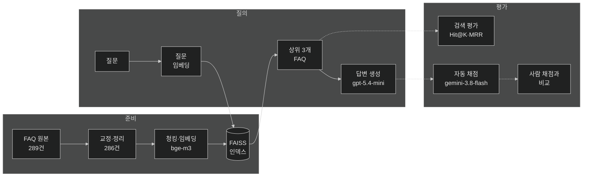

> 2026년 6~11월에 진행한 개인 프로젝트 기록입니다. 이 글은 재실험 결과를 기준으로 설명합니다.
>
> 코드와 실험 결과는 GitHub 저장소 [seo-yk/gosi-rag](https://github.com/seo-yk/gosi-rag)(태그 `experiment-v2`)에 있습니다.

## 1. 들어가며

공공데이터로 공개된 국가공무원 채용시험 FAQ로 질문에 답하는 RAG 챗봇을 만들고, 검색·생성·채점을 단계별로 평가한 기록입니다. RAG(검색 증강 생성)는 모델이 학습한 지식 대신, 지정한 문서에서 관련 내용을 먼저 검색해 그 문서만 근거로 답하는 방식입니다.

이 글은 전체 구조와 단계별 설계 기준을 다룹니다. 1차 실험 뒤 원본 데이터와 평가 방식에서 문제를 발견해 실험을 다시 했고, 본문 수치는 모두 재실험 결과입니다. 1차 실험의 문제와 개선 과정은 다음 글에서 다룹니다.

실험은 AI 도구(Claude)와 협업했습니다. 코드 작성·실행과 평가 문항 초안은 AI가 맡았고, 비교 기준과 평가셋 확정, 사람 채점처럼 결과를 좌우하는 판단은 직접 했습니다.

## 2. 전체 아키텍처

### 검색·생성·채점 단계별 평가 구조

파이프라인은 검색·생성·채점 세 단계로 나눴습니다. 답이 틀렸을 때 원인은 필요한 FAQ를 못 찾은 검색일 수도, 찾은 FAQ를 잘못 읽은 생성일 수도 있는데, 최종 답만 봐서는 둘을 구분할 수 없기 때문입니다.



평가에는 148문항과, FAQ에 답이 없는 범위 밖 질문 10문항을 썼습니다. 문항마다 정답 FAQ를 표시해 두어, 검색 결과에 정답 FAQ가 있는지와 생성한 답이 맞는지를 따로 셀 수 있습니다. FAQ가 여러 개 필요한 질문은 정답을 두 종류로 표시했습니다. 하나라도 빠지면 답을 완성할 수 없는 필수 근거와, 같은 내용이라 서로 대신 쓸 수 있는 대체 근거입니다. 두 가지를 함께 묻는 질문이라면 두 주제의 FAQ가 모두 검색돼야 성공입니다.

## 3. 검색 모델 고르기

### 모델 선택 기준: 5%p 이상의 성능 차이

148문항에서 한 문항은 약 0.7%p입니다. 두세 문항 차이로 우열을 가리면 평가셋이 조금만 바뀌어도 결론이 뒤집힙니다. 그래서 결과를 보기 전에 기준을 정했습니다. 두 구성의 차이가 5%p 이내면 우열을 가리지 않습니다.

### 임베딩 모델: 무료 다국어 모델 bge-m3 선택

임베딩 모델은 글의 의미를 숫자 벡터로 바꿔 질문과 FAQ의 유사도를 비교할 수 있게 해 줍니다. 모델 4개를 같은 평가셋으로 비교했고, 검색 성능은 두 지표로 봤습니다.

- **Hit@K:** 검색 결과 상위 K개 안에 정답 FAQ가 들어 있는 문항의 비율입니다. 필수 근거가 여러 개인 문항은 모든 필수 근거가 K개 안에 있어야 성공으로 셉니다.
- **MRR:** 정답 FAQ가 몇 번째에 나왔는지를 반영한 점수입니다. 1위면 1, 2위면 0.5, 3위면 0.33처럼 순위의 역수를 문항마다 구해 평균합니다. 1에 가까울수록 정답이 맨 위에 자주 나온다는 뜻입니다.

복수근거 37문항은 1위 결과 하나로 필수 근거를 모두 채울 수 없어 Hit@1이 항상 0입니다. 그래서 Hit@1과 MRR은 정답 FAQ가 하나인 111문항, Hit@5는 148문항 기준으로 계산했습니다. 아래 표는 모두 행 단위 청킹, 제목+본문 임베딩 기준입니다.

| 모델                            | Hit@1 (111문항) | Hit@5 (148문항) | MRR (111문항) |
|---------------------------------|----------------:|----------------:|--------------:|
| bge-m3                          |           97.3% |           98.7% |         0.985 |
| KURE-v1 (한국어 특화)           |           95.5% |           99.3% |         0.975 |
| text-embedding-3-large (OpenAI) |           92.8% |           98.7% |         0.959 |
| multilingual-e5-small           |           91.9% |           97.3% |         0.952 |

5%p를 넘은 차이는 bge-m3와 e5-small 사이(5.4%p) 하나뿐이었습니다. KURE-v1은 bge-m3를 한국어로 추가 학습한 모델이라 둘을 비교하면 추가 학습의 효과만 볼 수 있는데, 그 차이도 5%p 안이었습니다. 한국어 특화 모델이나 유료 API가 낫다는 근거가 없어, 무료 다국어 모델 bge-m3를 골랐습니다.

임베딩에는 제목과 본문을 함께 넣었습니다. 4개 모델 모두 제목만 넣을 때보다 Hit@1이 0.9~5.4%p 높았습니다. 1차 실험에서는 제목만 넣는 쪽이 낫다는 결론이었는데, 데이터를 교정하고 다시 실험하자 결론이 뒤집혔습니다.

### 청킹: FAQ 하나를 청크 하나로

문서를 검색 단위로 자르는 청킹은 행 단위를 택했습니다. 수치는 문장 단위가 0.9%p 높았지만 5%p 기준 안이었습니다. FAQ 본문이 평균 255자로 짧기 때문입니다. 행 단위는 검색 결과를 그대로 근거로 넘길 수 있어 생성 단계에서 추가 처리가 필요 없습니다.

| 청킹 방식  | 청크 하나에 담긴 내용 | Hit@1 (bge-m3, 111문항) | 생성 단계에 넘길 때              |
|------------|-----------------------|------------------------:|----------------------------------|
| 행 단위    | FAQ 하나              |                   97.3% | 검색 결과를 그대로 근거로 사용   |
| 문장 단위  | FAQ 속 문장 하나      |                   98.2% | 문장을 원래 FAQ로 다시 묶어야 함 |

## 4. 생성 실패 원인 나누기

### 정답 FAQ 조건으로 검색 실패와 생성 실패 구분

같은 148문항을 세 가지 조건으로 답하게 했습니다.

| 조건    | 생성 모델              | 근거          |          합격률 | 범위 밖 질문 차단 (사람 판정) |
|---------|------------------------|---------------|----------------:|------------------------------:|
| A       | gpt-5.4-mini           | 검색 결과 3개 | 93.2% (138/148) |                         10/10 |
| B       | gpt-5.4-mini           | 정답 FAQ      | 98.0% (145/148) |                     측정 안 함 |
| C       | EXAONE 3.5 7.8B (로컬) | 검색 결과 3개 | 69.6% (103/148) |                         10/10 |

A와 B는 생성 모델과 프롬프트가 같고, 근거로 주는 FAQ만 다릅니다.

- **A (실제 서비스 조건):** 검색이 찾은 상위 FAQ 3개를 보고 답합니다.
- **B (검색을 건너뛴 조건):** 평가셋에 표시해 둔 정답 FAQ를 바로 줍니다. 검색이 항상 성공했다고 가정한 셈입니다.

A에서 틀리고 B에서 맞으면 검색 문제, B에서도 틀리면 생성 문제입니다. A와 C는 검색 결과가 같고 생성 모델만 다릅니다. 세 조건의 프롬프트는 같습니다(temperature 0).

```python
# 생성 프롬프트 (예시)
def build_prompt(question, sources):
    contexts = "\n\n".join(
        f"[FAQ {s.row_id}]\n제목: {s.title}\n본문: {s.body}" for s in sources
    )
    return (
        "다음 규칙을 반드시 지켜 답변하세요.\n"
        "1. 제공된 FAQ만 근거로 답변합니다.\n"
        "2. FAQ에 없는 내용을 추측하지 않습니다.\n"
        "3. 근거가 부족하면 확인할 수 없다고 답변합니다.\n\n"
        f"사용자 질문: {question}\n\n검색된 FAQ:\n{contexts}"
    )
```

### 실패 10건 중 8건의 원인은 검색 단계

A의 실패 10건 중 8건은 검색이 필요한 FAQ를 찾지 못한 경우였고, 8건 모두 FAQ가 2개 이상 필요한 복수근거 질문이었습니다. 질문의 중심 주제로 검색이 몰리면서 두 번째 주제의 FAQ를 놓친 것입니다. 이 중 5건은 빠진 부분을 "확인할 수 없다"고 답했고, 1건은 빠뜨렸으며, 2건은 근거 없이 틀리게 답했습니다.

필요한 FAQ가 검색된 140문항만 보면 A의 합격률은 98.6%로, 정답 FAQ를 직접 받은 B(98.0%)와 비슷합니다. 검색이 필요한 FAQ를 가져오면 생성 모델은 정답을 직접 받은 경우만큼 답했습니다. 이 데이터에서는 검색이 병목입니다.

나머지 2건은 필요한 FAQ를 받고도 틀린 경우입니다. 답안지 과목 순서를 묻는 질문에서 원문은 '순서를 바꾸어 표기하여도, 문제책 순서대로 채점이 되므로 착오 없으시기 바랍니다'로, 바꾸면 오답이 될 수 있다는 주의였습니다. 모델은 이를 '바꿔도 된다'로 해석했습니다.

### 로컬 모델의 근거 밖 답변

C는 A와 같은 검색 결과와 프롬프트를 받고도 합격률이 23.6%p 낮았습니다. 필요한 FAQ가 검색된 문항에서도 37건이 실패했고, 그중 36건에 존재하지 않는 URL이나 FAQ에 없는 규정 같은 근거 밖 내용이 섞여 있었습니다. 범위 밖 질문 10개에는 A와 C 모두 근거가 없다고 답했습니다(사람 판정).

## 5. 채점기 검증

### 사람 채점 40문항 기준의 채점기 선정

생성 결과는 LLM 채점기가 아래 네 가지 기준으로 채점합니다.

- `groundedness` (근거성): 답변 내용이 제공된 FAQ에 있는지 (0~2점)
- `correctness` (정확성): 답한 내용이 맞는지. 빠뜨린 부분은 여기서 보지 않습니다 (0/1)
- `groups_covered` (필요한 내용 포함): 필수 근거마다 답했는지 (근거마다 0/1)
- `unjustified_refusal` (답 회피): FAQ에 답이 있는데도 "확인할 수 없다"며 피했는지 (0/1)

근거성 2점, 정확성 1점, 필수 근거 모두 충족, 답 회피 0이면 합격입니다. 합격 판정은 채점기가 아니라 파이썬 코드가 점수로 계산합니다.

LLM 채점 결과를 바로 믿지는 않았습니다. A와 B의 답변 40문항을 모델 이름과 조건을 가린 채 직접 채점하고, 채점기 후보 6개가 사람 판정과 얼마나 같은지 비교했습니다. 후보는 로컬 모델 2개(gemma3 4B, qwen2.5 7B)와 Gemini 4개(2.5·3.5·3.7·3.8-flash)입니다. OpenAI 모델은 생성 모델과 같은 계열이라 자기 계열 답변을 후하게 볼 수 있어 후보에서 뺐습니다.

로컬 모델 2개는 맞는 답에도 0점을 주는 경우가 많아 일치율이 30~40%였습니다. gemini-3.8-flash는 90.0%였고, 불일치 문항을 다시 가린 채 재채점한 뒤 95.0%(kappa 0.64, 우연한 일치를 뺀 일치도)가 됐습니다. 3.5·3.7-flash는 3.8-flash와 판정이 같아 최신인 3.8-flash를 골랐고, 2.5-flash는 무료 사용 한도에 걸려 24문항만 채점했습니다.

### 채점기 비교 중 드러난 사람 채점의 오류

제 채점도 고쳐야 했습니다. EXAONE 답변 15문항을 처음 채점할 때 14문항을 통과시키며 "질문한 내용만 답하고 가독성이 좋다"고 메모했습니다. 채점기와 판정이 갈린 7건을 채점기가 지적한 내용(근거에 없는 URL, 근거에 없는 "공고일" 기준)을 기준으로 원문 FAQ와 대조하자, 6건을 불합격으로 바꿨습니다. 매끄러운 답변이 근거 밖 오류를 가린 것입니다. 이후 가독성이 떨어지더라도 정확한 정보를 우선한다는 채점 원칙을 정했습니다.

재검토 뒤 채점기와의 일치는 8/15에서 14/15가 됐습니다. 다만 이 재검토는 채점기 의견을 본 뒤 한 것이라, 채점기에 맞춰진 순환이 섞여 있을 수 있습니다. 그래서 재검토 전후 수치를 모두 기록했습니다.

## 6. 조용히 틀리는 대신 멈추기

### 오류 없이 틀리는 세 가지 경우와 실행 중단 장치

에러 없이 끝나지만 결과는 틀린 조용한 실패(silent failure)를 세 가지 발견했습니다. 결과만 봐서는 알아채기 어려워, 조건이 맞지 않으면 실행을 멈추거나 따로 집계하도록 바꿨습니다.

- **임베딩 모델 불일치:** bge-m3와 KURE-v1은 벡터 차원(1024)이 같아, 인덱스를 만든 모델과 질문을 임베딩한 모델이 달라도 오류 없이 검색 결과가 나왔습니다. 지금은 인덱스마다 데이터 해시와 모델 이름을 저장하고, 검색 전에 대조해 다르면 멈춥니다.
- **Ollama 입력 잘림:** Ollama는 컨텍스트 길이를 지정하지 않으면 2,048토큰으로 잡고, 더 긴 입력은 앞부분을 경고 없이 잘라낸 채 답합니다. 맨 앞의 규칙과 질문이 빠질 수 있다는 뜻입니다. A 조건 채점 프롬프트 148개 중 2개가 이 길이를 넘었습니다. 컨텍스트를 8K로 늘리고, 입력이 한도에 닿으면 생성을 멈추게 했습니다.
- **채점 결과 파싱 실패:** 채점기는 점수를 JSON으로 돌려주고, 코드가 이를 읽어 합격 여부를 계산합니다. 전에는 형식이 깨져 읽지 못한 응답을 불합격으로 셌습니다. 답변이 틀린 경우와 채점이 실패한 경우가 섞인 것입니다. 지금은 최대 두 번 재요청하고, 그래도 읽지 못하면 error로 따로 셉니다.

```python
# 입력이 컨텍스트 한도에 닿으면 멈추기 (예시)
def check_not_truncated(response, context_limit):
    prompt_tokens = response.usage.prompt_tokens
    if prompt_tokens >= context_limit - MARGIN:
        raise RuntimeError(
            f"입력 {prompt_tokens}토큰이 한도({context_limit})에 닿아 앞부분이 잘렸을 수 있습니다."
        )
```

## 7. 한계

사람 채점자가 1명뿐이라 다른 사람과 판정이 얼마나 일치하는지 확인하지 못했습니다.

채점기는 사람보다 합격을 후하게 주는 경향도 있었습니다(40문항 기준 92.5% 대 87.5%). 4장의 답안지 순서 문항도 B 조건에서는 합격으로 판정했는데, 해당 1건을 빼면 B의 합격률은 97.3%입니다.

## 8. 정리

공무원 채용시험 FAQ 286건으로 RAG 챗봇을 만들고, 검색·생성·채점을 나눠 평가했습니다. 5%p 기준을 먼저 세운 뒤 bge-m3와 행 단위 청킹을 골랐고, 정답 FAQ를 주는 조건으로 생성 실패의 원인을 갈랐습니다. 채점기는 사람 채점 40문항과 비교해 고른 뒤 사용했으며, 오류 없이 틀리는 세 가지 경우에는 실행을 멈추거나 따로 집계하는 장치를 두었습니다.

최종 답만 채점했다면 A의 실패 10건이 검색 탓인지 생성 탓인지 가려낼 수 없었을 것입니다. 8건의 원인이 검색에 있다고 말할 수 있었던 것은 검색 없이 정답 FAQ를 직접 제공한 B와 비교한 덕분입니다.

채점기 비교 실험은 제 채점의 편향을 돌아보는 계기도 됐습니다. 가독성이 좋다며 통과시켰던 EXAONE 답변 중 상당수가 원문 FAQ와 대조해 보니 불합격이었습니다. 매끄러운 문장(유창성)에 속아 근거 밖 오류를 놓친 것입니다. 사람의 채점 역시 원문 근거와 일일이 대조하는 과정을 거쳐야 신뢰할 수 있음을 확인했습니다.

## 9. 저장소

- 저장소: [seo-yk/gosi-rag](https://github.com/seo-yk/gosi-rag) (재실험 기준 태그 `experiment-v2`)
- 검색 실험: `docs/1_retrieval.md`, 12조합 전체 지표 `results/retrieval_v1.3/comparison.md`
- 생성 실험: `docs/2_generation.md`, 결과 `results/generation_v1.3/`
- 채점기 검증: `docs/3_judge_validation.md`, 사람 채점 원본 `evaluation/human_review/`
- 결정 기록: `docs/experiment_log.md`
