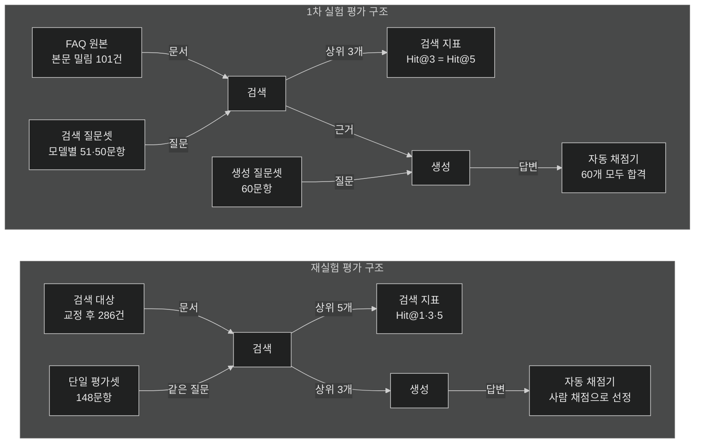

> 2026년 6~11월 개인 프로젝트를 정리한 글입니다. 이 글의 1차 실험 수치는 모두 폐기한 수치입니다. 코드와 실험 결과는 [seo-yk/gosi-rag](https://github.com/seo-yk/gosi-rag)에서 확인할 수 있습니다.

## 1. 들어가며

[1편]()에서는 재실험 결과를 기준으로 RAG 시스템과 평가 구조를 설명했습니다. 이 글은 그 재실험을 하게 된 1차 실험을 다룹니다. 1차 실험의 성능 수치는 높았지만, 다시 들여다보니 그 수치를 만든 평가 설계에 문제가 있었습니다.

제가 1차 실험을 다시 보며 확인한 내용은 세 가지입니다.

- 원본 FAQ 101건의 본문이 한 칸씩 밀려 있었지만, 평가셋에 그 구간을 묻는 문항이 없어 지표로는 드러나지 않았습니다(3장).
- 모델마다 다른 질문셋으로 비교해, 모델 비교와 임베딩 입력에 대한 결론이 근거를 잃었습니다(4장).
- 자동 채점기가 60문항 전부를 합격으로 판정해, 높은 일치율이 채점기의 실력을 뜻하지 않았습니다(6장).

## 2. 1차 실험의 세 가지 목표

저는 1차 실험에서 국가공무원 채용시험 FAQ 289건으로 RAG 시스템을 만들고, 세 가지를 확인하도록 실험을 설계했습니다.

1. 같은 질문셋에서 청킹 방식·임베딩 모델·임베딩 입력·검색 범위 가운데 무엇이 검색 성능을 바꾸는가
2. 답변 품질이 떨어질 때 원인이 검색 누락인지 생성 모델의 응답인지 나눠 추적할 수 있는가
3. 로컬 소형 채점기가 사람 채점을 어디까지 대신할 수 있는가

모든 스크립트가 실행 오류 없이 끝났고, 결과 파일에도 빈칸이 없었습니다. 당시 저장소 README에 남긴 결과와 결론은 다음과 같습니다.

| 항목      | 1차 결과 (폐기 수치)                                    | 1차 결론                                                              |
|-----------|---------------------------------------------------------|-----------------------------------------------------------------------|
| 검색 조합 | e5-small·행 단위·제목 임베딩, Hit@1 90.2%, Hit@5 96.1%  | 제목만 임베딩 우세                                                    |
| 모델 비교 | e5-small 90.2%, text-embedding-3-large 68.0% (Hit@1)    | 경량 오픈소스 모델(e5-small) 우세                                     |
| 자동 채점 | 채점기 합격 60/60, 사람 합격 55/60, 일치율 91.67%       | 사람 평가자 간 일치도보다 높은 일치 |

하지만 재실험을 준비하며 입력 데이터·평가셋·지표 계산 코드·채점 결과를 행 단위로 다시 열어 보니, 세 결론을 모두 다시 측정해야 했습니다. 확인하려던 목표는 재실험에서도 같았고, 바뀐 것은 목표를 재는 방법입니다. 이 글은 측정이 목표에서 어긋난 지점을 진단하고, 재실험에서 어떤 평가 설계로 바꿨는지 짝지어 설명합니다. 두 실험의 평가 구조 차이는 아래와 같습니다.

## 3. 모든 비교의 바닥에 있던 FAQ 데이터

### 제목과 본문이 어긋난 문서

원본 FAQ의 연번 100~200 구간 101건은 본문이 한 칸씩 위로 밀려 있었습니다. 원본 99번(사관학교 중퇴) 행의 본문은 실제로 100번(대학 소재지 이전) 질문의 답이었고, 99번의 본래 본문은 원본 어디에도 없었습니다. 1차 실험은 원본을 그대로 인덱싱했으므로, 101개 문서가 제목과 본문이 서로 다른 질문을 가리키는 상태로 검색 대상에 들어갔습니다.

어긋난 문서가 결과에 영향을 주는 경로는 두 갈래입니다. 제목+본문 임베딩은 두 질문의 의미가 섞인 벡터를 만들고, 생성 단계는 검색된 문서의 본문을 근거로 답하므로 다른 질문의 답이 그대로 근거가 됩니다. 제목만 임베딩한 1차 최종 조합은 검색 단계의 영향이 상대적으로 작았을 수 있지만, 본문을 넘겨받는 생성 단계는 임베딩 조합과 관계없이 영향을 받습니다.

### 오류 구간을 비켜 간 평가셋

1차 지표에는 이 결함이 나타나지 않았습니다. 1차의 검색 질문셋(51문항·50문항)과 생성 질문셋(60문항)을 정답 FAQ 번호로 대조하면, 연번 100~200의 FAQ를 정답이나 보조 근거로 둔 문항이 한 개도 없습니다. 밀린 문서는 다른 질문의 오답 후보로만 인덱스에 있었고, 평가셋은 해당 구간을 정답으로 묻지 않았습니다. 평가셋이 데이터의 일부 구간만 다루면, 그 바깥의 데이터 오류는 지표가 높아도 검출되지 않습니다.

### 원본 보존과 단계별 데이터 파일

재실험에서는 원본을 수정하지 않고, 처리 단계마다 파일을 나눴습니다. 원본과 대조할 수 있도록 연번은 다시 매기지 않았습니다. 데이터 파일의 단계별 건수와 처리 내용은 다음과 같습니다.

| 단계      | 파일                | 건수 | 처리 내용                                                        |
|-----------|---------------------|-----:|------------------------------------------------------------------|
| 원본      | `faq_raw.csv`       |  289 | 변경 없음                                                        |
| 교정본    | `faq_corrected.csv` |  289 | 본문 밀림 101건 복원, 99번 본문 유실 확인, 200번 본문 대체, 공백 18건 제거 |
| 검색 대상 | `faq_v2.csv`        |  286 | 근접 중복 2건 병합(94·152), 본문 없는 99번 제외, 15번 반복 본문 정리 |

교정은 제가 원본을 직접 대조하며 진행했고, 교정이 끝난 뒤 원본과 교정본을 행 단위로 비교해 변경 내역을 `data/README.md`에 정리했습니다. 교정 구간에서는 교정본 k번째 행의 본문이 원본 k−1번째 행의 본문과 같습니다. 재실험 평가셋은 148문항 중 48문항이 연번 100~200의 FAQ를 필수 근거로 요구하므로, 교정한 구간도 지표의 측정 범위 안에 들어갑니다.

## 4. 같은 질문셋이라는 전제가 깨진 검색 비교

첫 번째 목표는 구성 요소별 비교를 통해 검색 성능을 바꾸는 요소를 확인하는 것이었습니다. 그런데 실제 결과 파일에서는 질문셋·지표 계산·청킹 방식 세 곳에서 같은 조건으로 비교한다는 전제가 성립하지 않았습니다.

### 날짜가 다른 두 질문셋

1차 검색 결과는 모델마다 다른 질문셋으로 계산됐습니다. e5-small 결과는 6월 27일 커밋의 51문항 질문셋으로, OpenAI 임베딩 결과는 6월 29일에 다시 정리한 50문항 질문셋으로 계산됐습니다. 결과 파일에 질문셋 이름이 남아 있지 않았기 때문에, e5-small 결과의 실패 기록 순서를 51문항 질문셋의 정답 순서와 대조해 입력을 역추적했습니다. 두 질문셋은 문항 수만 다른 것이 아니라 문장이 같은 질문이 하나도 없었고, 유형 구성도 달랐습니다.

| 구분                   | e5-small 입력                          | OpenAI 입력                                    |
|------------------------|----------------------------------------|------------------------------------------------|
| 작성 시점              | 6월 27일                               | 6월 29일                                       |
| 문항 수                | 51                                     | 50                                             |
| 유형 구성              | 일상표현 40·복합질문 7·원문유사 4      | 일상표현 24·복합질문 12·원문유사 7·조건형 7   |
| 제목 임베딩 Hit@1      | 90.2%                                  | 68.0% (text-embedding-3-large)                 |
| 제목+본문 임베딩 Hit@1 | 86.3%                                  | 70.0% (text-embedding-3-large)                 |

경량 오픈소스 모델이 낫다는 결론은 e5-small과 text-embedding-3-large의 Hit@1 차이 22.2%p에서 나왔습니다. 두 값은 서로 다른 질문셋에서 측정됐으므로, 차이 가운데 모델의 몫과 질문셋의 몫을 나눌 수 없습니다. 제목만 임베딩하는 편이 낫다는 결론도 e5-small 결과에서 나왔습니다. 같은 비교를 OpenAI 쪽 질문셋에서 하면 제목+본문 임베딩이 2.0%p 높아 방향이 반대였습니다.

재실험에서는 임베딩 모델 4개를 같은 148문항·같은 데이터·같은 평가 코드로 비교했습니다. 행 단위·제목 임베딩 구성의 Hit@1(정답 FAQ가 하나인 111문항 기준)은 e5-small 90.1%, text-embedding-3-large 91.0%였습니다. 1차에서 22.2%p였던 두 모델의 차이는 0.9%p로 줄었고, 결과를 보기 전에 정한 5%p 기준([1편]() 3장)으로는 우열이 확인되지 않습니다. 제목+본문 임베딩은 네 모델 모두에서 제목만 임베딩보다 Hit@1이 0.9~5.4%p 높았습니다. 본문 교정의 효과일 가능성이 있습니다(8장).

1차와 재실험의 수치는 데이터·문항·평가 기준이 모두 달라 같은 눈금으로 비교하지 않으며, 재실험 Hit@1의 기준은 1편 3장에 있습니다.

### Hit@3과 같은 값을 낸 Hit@5

1차 검색 결과 파일에서는 모든 조합의 Hit@3과 Hit@5가 같았습니다. 상위 3개만 검색한 결과로 Hit@5를 계산했기 때문에, 4위와 5위 문서는 집계에 들어갈 수 없었습니다. Top 3 행과 Top 5 행의 네 지표(Hit@1·3·5, MRR)도 서로 같아, 검색 범위를 바꾼 비교는 두 조건을 구분하지 못했습니다. 재실험에서는 질문마다 5개를 한 번 검색하고 그 결과에서 Hit@1·3·5를 함께 계산하며, Top-K는 검색 실험의 비교 축에서 뺐습니다.

### 행 단위와 같아진 문단 단위 청킹

1차는 행 단위·문단 단위·파일 단위 청킹을 비교했습니다. 문단 단위 청킹은 빈 줄을 기준으로 본문을 나누는데, FAQ 본문에는 빈 줄이 없어 모든 문단 청크가 행 단위 청크와 같았습니다. e5-small 결과에서 두 방식의 네 지표가 완전히 같은 이유입니다. 파일 단위는 FAQ 전체를 청크 하나로 만들어 모든 지표가 0이었고, text-embedding-3-small은 입력 한도 8,192토큰을 넘어 제목+본문 조합을 실행하지 못했습니다. 결과적으로 측정된 청킹 방식은 행 단위 하나였습니다.

1차는 결과를 해석하며 본문에만 있는 세부 키워드가 검색되지 않는다는 가설을 남겼습니다. 재실험에서는 문단 단위 대신 문장 단위 청킹(634청크)을 넣어 이 가설을 직접 확인했습니다. 같은 FAQ의 문장이 상위권을 채우지 않도록 FAQ 번호로 중복을 지운 뒤 지표를 계산했으며, 결과는 1편 3장에 있습니다.

## 5. 검색과 생성을 같은 문항으로 잇지 못한 평가셋

### 따로 만든 검색용·생성용 질문셋

두 번째 목표는 분리 평가를 통해 실패 원인이 검색인지 생성인지 확인하는 것이었습니다. 1차 README도 답변 품질을 두 단계로 나눠 봐야 한다고 결론을 냈습니다. 그런데 1차는 검색 평가에 50문항, 생성 평가에 60문항을 따로 썼습니다. 같은 질문이 검색과 생성 양쪽에 있지 않으므로, 생성 답변이 틀렸을 때 그 질문의 검색이 성공했는지 같은 문항 기준으로 확인할 방법이 없었습니다.

### 하나만 찾아도 성공인 복합질문

검색 질문셋 50문항 중 12문항은 두 주제를 함께 묻는 복합질문이었습니다. 그중 11문항은 정답 FAQ를 하나만 표기했고, 두 개를 표기한 1문항도 둘 중 하나만 검색되면 성공으로 집계했습니다. 두 번째 주제의 FAQ를 놓쳐도 Hit@K는 떨어지지 않으므로, 복합질문의 검색 성능은 실제보다 높게 기록되는 구조였습니다.

### 하나로 합친 평가셋과 필수 근거 그룹

재실험에서는 두 질문셋을 하나의 평가셋(148문항과 범위 밖 질문 10문항)으로 합쳤습니다. 같은 문항이 검색 지표·생성 합격 여부·채점기 검증에 모두 쓰이므로, 정답 FAQ를 직접 준 조건과 비교해 생성 실패를 검색 누락과 생성 오류로 나누는 1편 4장의 분석이 가능해졌습니다. 1차가 결론으로 적었던 분리 평가를 같은 문항 위에서 실제로 측정한 셈입니다.

여러 FAQ가 필요한 질문은 모든 필수 근거가 상위 K개 안에 있어야 성공으로 세도록 성공 판정 방식을 바꿨고(1편 2장), 재실험 평가셋 초안의 복합질문 유형은 실제 근거 수를 기준으로 복수근거 37문항과 다른 유형 10문항으로 다시 분류했습니다. 재실험에서 gpt-5.4-mini가 검색 결과로 답한 조건의 실패 10건 중 8건은 복수근거 문항의 검색 누락이었는데, 1차의 표기 방식이었다면 검색 실패로 잡히지 않았을 수 있는 유형입니다.

## 6. 사람 채점을 대신하는지 잰 방법

### 일치율 91.67%가 가리킨 값

세 번째 목표는 사람 판정과의 비교를 통해 로컬 소형 채점기가 사람 채점을 대신할 수 있는지 확인하는 것이었습니다. 1차 자동 채점기(`gemma3:4b`)는 생성 답변 60개를 모두 합격으로 판정했습니다. 사람 판정은 합격 55개·불합격 5개였으므로, 일치율 55/60(91.67%)은 사람의 합격 비율과 같은 값입니다. 사람이 불합격으로 본 5개 중 채점기가 불합격으로 판정한 답변은 0개였습니다. 판정이 합격 쪽으로 쏠린 데이터에서는 무조건 합격만 내는 채점기도 높은 일치율을 얻으므로, 일치율만으로는 채점기가 틀린 답을 걸러내는지 판단할 수 없습니다.

1차 채점 프롬프트 60개 중 1개는 Ollama 기본 컨텍스트 2,048토큰을 넘어 앞부분이 잘린 채 채점됐습니다. 1건이므로 결과 전체에 준 영향은 작았고, 잘림을 막는 장치는 1편 6장에서 다뤘습니다.

### 1차 채점에서 얻은 두 가지 발견

1차 채점 과정에서 재실험으로 이어진 발견도 두 가지 나왔습니다. 첫째, 사람과 채점기의 불일치는 주로 근거 FAQ에 답이 있는데 답을 피한 응답에서 나왔습니다. 1차 루브릭에는 회피를 판정하는 항목이 없었고, 근거성 1점(일부만 근거)도 합격으로 인정했습니다. 둘째, 비용을 줄이려고 3문항씩 묶어 채점하는 배치 방식을 시험했는데, 판정이 단건 채점과 어긋나 저는 소형 로컬 채점기에는 단건 채점을 택했습니다.

### kappa와 불합격 검출로 바꾼 검증 기준

재실험 루브릭은 1차에서 발견한 회피 응답을 `unjustified_refusal` 항목으로 따로 채점하고, 근거성 2점만 합격으로 인정하며, 필수 근거 그룹별 충족을 확인합니다. 채점기 검증에는 일치율 대신 우연한 일치를 뺀 Cohen's kappa와 사람 불합격 검출 수를 함께 씁니다. 같은 4B 로컬 채점기를 새 루브릭으로 시험하자, FAQ에 그대로 있는 내용으로 맞게 답한 답변에도 근거성 0점·정확성 0점을 주었습니다. 1차의 높은 일치율은 채점기의 판단력보다 느슨한 루브릭에서 나왔을 가능성이 있습니다. 재실험은 채점기를 미리 정하지 않고, 블라인드 사람 채점 결과와 가장 잘 맞는 후보를 골랐습니다(1편 5장).

## 7. 결과 파일 바깥에서 찾은 결함

앞의 결함은 모두 실행 오류를 내지 않았습니다. 결과 파일의 값만 보면 정상이었고, 입력 데이터와 질문셋, 지표 계산 코드, 행 단위 판정 결과를 직접 열어야 드러났습니다. 1차에는 결과 파일을 입력과 코드에 대조하는 절차가 없었습니다. 재실험에서 제가 추가한 절차는 다음과 같습니다.

- 결과를 보기 전에 판단 기준(5%p) 고정
- 입력 데이터·평가셋·코드를 행 단위로 대조
- 채점기는 사람 채점과 비교해 선택
- 버린 결과는 지우지 않고 폐기 사유와 함께 보관

1차 파일은 내용을 바꾸지 않고 `archive/experiment-v1/`로 옮겼고, 당시 저장소 상태는 태그 `experiment-v1`로 고정했습니다. 폐기 사유는 결과 파일 옆 README와 `docs/experiment_log.md` 1장에 남겼습니다. 1차가 남긴 목표와 가설이 재실험 설계의 출발점이 됐으므로, 저는 버린 결과도 이유와 함께 저장소에 남겨 두었습니다.

## 8. 진단으로 확인하지 못한 부분

재실험은 데이터 교정·평가셋 통합·지표 계산·채점 기준을 한꺼번에 바꿨습니다. 결함을 하나씩 고친 중간 실험은 하지 않았으므로, 결함별로 1차 수치가 얼마나 달라졌는지는 측정하지 않았습니다. 제목+본문 임베딩의 역전이 본문 교정에서 왔는지 질문셋 변경에서 왔는지도 같은 이유로 나누지 못했습니다.

교정본의 변경 내역은 교정이 끝난 뒤 두 파일을 비교해 정리한 것입니다. 무엇이 바뀌었는지는 행 단위로 확인할 수 있지만, 교정 당시 거친 판단 과정은 기록으로 남아 있지 않습니다.

## 9. 저장소

- 저장소: [seo-yk/gosi-rag](https://github.com/seo-yk/gosi-rag)
- 1차 질문셋·결과와 폐기 사유: `archive/experiment-v1/README.md`, 태그 `experiment-v1`
- 데이터 변경 내역: `data/README.md`
- 재실험 결정 기록: `docs/experiment_log.md` (1장 1차 폐기 사유, 8-3 루브릭 변경)
- 재실험 결과: 태그 `experiment-v2`
